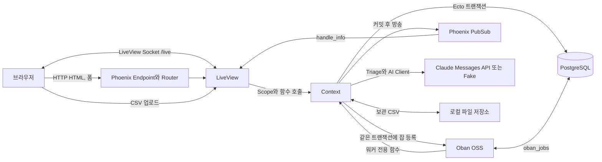

# API 연동 규격서

- 작성일: 2026-10-20
- 작성자: D2, Codex `gpt-6-astra` max
- 상태: 초안
- 기준 커밋: `f5f7f78` (`feature/m2-rule-engine` 기준, 작성 브랜치 `docs/api-spec`)
- 관련 문서:
  - [시스템 구조와 데이터 모델](2026-10-17-4-시스템-구조와-데이터-모델.md): 이하 "계약". 2.1 공개 함수, 5장 잡, 6장 PubSub, 7장 AI, 9장 CSV, 12.3 S5 후속, 12.4 ID 체계
  - [MVP 범위와 일정](../planning/2026-10-17-2-MVP-범위와-일정.md): 2장 시나리오, 5장 GL 계약
  - [WBS와 마일스톤](../planning/2026-10-17-8-WBS와-마일스톤.md), [현재 작업](../../TASKS.md)
  - [분개 테스트 룰과 감사 용어](../domain/2026-10-17-3-분개테스트-룰과-감사-용어.md): 4장 AI, 7장 합성 데이터
  - [화면설계서](../design/2026-10-17-13-화면설계서.html), [디자인 시스템](../design/2026-10-17-5-디자인-시스템.md)
  - [요구사항 명세서](../planning/2026-10-20-9-요구사항-명세서.md): 작성 중, 링크 존재 확인 제외
  - [기능 정의서](../planning/2026-10-20-10-기능-정의서.md): 작성 중, 링크 존재 확인 제외

## 1. 목적과 범위

이 문서에서 "API 연동 규격"은 브라우저, 웹 프로세스, 도메인 context, 비동기 잡, 메시지 버스, 파일, 외부 AI 사이의 경계를 넘는 인터페이스를 뜻한다. Tickmark는 HTML과 LiveView 이벤트로 동작하는 Phoenix 앱이다. `:api` 파이프라인은 선언되어 있지만 사용하는 라우트가 없으므로 REST/JSON 엔드포인트 목록만으로는 실제 연동을 설명할 수 없다. 근거: `lib/tickmark_web/router.ex:6`, `lib/tickmark_web/endpoint.ex:14`, 계약 1장.

기준 커밋의 코드와 테스트 파일을 읽어 실제 입력, 권한, 반환, 상태 변경, 감사 이벤트를 기록한다. 이 문서는 실행 결과 보고서가 아니며 테스트, 서버 기동, Claude 실호출을 새로 수행하지 않았다. "구현"은 코드와 대응 테스트가 존재한다는 뜻이며, 배포 완료나 외부 서비스 호환성 검증을 뜻하지 않는다. 외부 ERP 연동, 실데이터 처리, 다중 통화는 범위 밖이다. 근거: MVP 3-4장, `AGENTS.md` 1장과 8장.

## 2. 용어와 ID 체계

| 종류 | ID 형식 | 식별 단위 |
|---|---|---|
| HTTP | `IF-HTTP-nn` | router의 경로 선언 또는 개발 도구의 마운트 지점 |
| LiveView | `IF-LV-nn` | 화면별 이벤트 또는 수신 메시지 처리 묶음 |
| PubSub | `IF-PS-nn` | 토픽과 메시지 종류의 조합 |
| Oban | `IF-JOB-nn` | 워커 |
| 외부 서비스 | `IF-EXT-nn` | Claude Messages 연동 경계 |
| 파일 | `IF-FILE-nn` | GL CSV 입력 계약 |
| context | `IF-CTX-nn` | 웹에서 쓰거나 연결 예정인 공개 함수 |

ID는 계약 12.4를 따른다. 같은 함수의 기본 인자에 따른 arity 변형은 같은 ID로 묶는다. `REQ`, `FN` ID는 참조하지 않는다.

| 용어 | 의미와 코드 근거 |
|---|---|
| S1 / S2 / S3 | 감사 대상 목록 / 감사 대상 상세 / GL 불러오기. `EngagementLive.Index`, `EngagementLive.Show`, `ImportLive.New` |
| S4 / S5 / S6 | 테스트 실행 / 전표 검토 / 감사 로그. `TestRunLive.Show`, `FindingLive.Show`, `AuditLive.Index` |
| Scope | `Tickmark.Accounts.Scope`, 로그인 사용자만 담음. 역할은 `Engagements.fetch_role/2`로 조회 |
| preparer / reviewer | 작성자 / 검토자. 권한은 `lib/tickmark/engagements/policy.ex:20` |
| finding | 룰이 적중한 전표의 검토 항목. 사람 판단 `status`와 AI `triage_status`는 별도 필드. `lib/tickmark/testing/finding.ex` |
| changeset | Ecto의 필드 변환과 검증 결과. 업무 거부 원자와 구별하여 폼에 표시 |
| 구현 / 부분 | 코드와 테스트 있음 / 경계의 일부만 연결됨 |
| 미구현 / 진행 중 / 확인 필요 | 계획만 있음 / W6, F1, F2 등의 후속 작업 / 근거 또는 실행 검증 부족 |

이하 웹 모듈은 `TickmarkWeb.`, context 모듈은 `Tickmark.` 접두사를 생략한다. UUID는 문자열이고 LiveView 폼 파라미터의 키와 값은 기본적으로 문자열이다. Ecto가 정수, 날짜, Decimal, enum으로 변환한다. PubSub 내부 맵은 atom 키, Oban args와 JSON 저장 payload는 문자열 키다. 근거: 각 LiveView의 `handle_event/3`, 계약 2.1, 4.2, 5.2, 6장.

## 3. 시스템 경계



Endpoint는 `/live`에 WebSocket과 longpoll을 모두 설정하고 세션 정보를 넘긴다. 업무 화면은 접속된 mount에서만 구독한다. `Tickmark.Repo`, Oban, `Tickmark.PubSub`, Presence, Endpoint가 supervision tree에 등록되어 있다. Presence의 화면 추적은 아직 연결 전이다. 근거: `lib/tickmark_web/endpoint.ex:14`, `lib/tickmark/application.ex:10`, `lib/tickmark_web/live/engagement_live/show.ex:23`, 6.2절.

## 4. IF-HTTP: 라우트, 인증, 세션

### 4.1 공통 파이프라인과 live_session

| 약어 | 실제 구성 | 근거 |
|---|---|---|
| B | `:browser`: HTML accepts, session, live flash, root layout, CSRF 보호, secure browser headers, `fetch_current_scope_for_user` | `router.ex:6` |
| A | `[:browser, :require_authenticated_user]` | `router.ex:50` |
| LA | `live_session :require_authenticated_user`, `on_mount: [{TickmarkWeb.UserAuth, :require_authenticated}]` | `router.ex:53` |
| LC | `live_session :current_user`, `on_mount: [{TickmarkWeb.UserAuth, :mount_current_scope}]` | `router.ex:75` |
| LS | LA에 Settings 모듈의 `on_mount {TickmarkWeb.UserAuth, :require_sudo_mode}` 추가 | `live/user_live/settings.ex:4` |

위 표의 `router.ex`, `live/...`는 `lib/tickmark_web/` 아래 경로다. A와 LA에서 비로그인 사용자는 `/users/log-in`으로 리다이렉트된다. `get_...!` 조회의 없는 UUID, 잘못된 UUID, 비멤버는 `Ecto.NoResultsError`로 같은 404 경로를 사용한다. S4/S5는 상위 `:id`와 하위 run/finding의 engagement가 달라도 404다. 근거: `user_auth.ex:219`, `user_auth.ex:271`, `Engagements.get_engagement!/2`, `TestRunLive.Show.mount/3`, `FindingLive.Show.mount/3`.

### 4.2 업무와 인증 라우트

모든 GET LiveView는 최초 HTML 렌더 뒤 `/live` 연결에서 화면을 갱신한다. 다음은 `router.ex`의 일반 라우트 선언 전부다.

| ID | 메서드 | 경로 | 파이프라인 | live_session / on_mount | 모듈과 action | 인증과 응답 | 화면 / 근거 |
|---|---|---|---|---|---|---|---|
| IF-HTTP-01 | GET | `/` | B | 없음 | `PageController.home/2` | 불필요, HTML; 기준 커밋은 로그인 후에도 home 렌더 | 홈, `router.ex:23`, `controllers/page_controller.ex:4` |
| IF-HTTP-02 | GET | `/users/settings` | A | LS | `UserLive.Settings :edit` | 로그인과 최근 재인증 필요; HTML 또는 로그인 리다이렉트 | 인증, `router.ex:55` |
| IF-HTTP-03 | GET | `/users/settings/confirm-email/:token` | A | LS | `UserLive.Settings :confirm_email` | 성공/실패 flash 후 `/users/settings`로 이동 | 인증, `router.ex:56`, `Settings.mount/3` |
| IF-HTTP-04 | GET | `/engagements` | A | LA | `EngagementLive.Index :index` | 로그인 필요; 내 멤버십 목록 HTML | S1, `router.ex:60` |
| IF-HTTP-05 | GET | `/engagements/new` | A | LA | `EngagementLive.Index :new` | 로그인 필요; 같은 목록의 생성 폼 HTML | S1, `router.ex:61` |
| IF-HTTP-06 | GET | `/engagements/:id` | A | LA | `EngagementLive.Show :show` | 멤버 필요; HTML 또는 공통 404 | S2, `router.ex:62` |
| IF-HTTP-07 | GET | `/engagements/:id/imports/new` | A | LA | `ImportLive.New :new` | 멤버 필요; 검토자도 HTML 권한 거부 상태를 봄, 비멤버 404 | S3, `router.ex:63`, `ImportLive.New.mount/3` |
| IF-HTTP-08 | GET | `/engagements/:id/runs/:run_id` | A | LA | `TestRunLive.Show :show` | 멤버 필요; HTML 또는 공통/소속 불일치 404 | S4, `router.ex:64` |
| IF-HTTP-09 | GET | `/engagements/:id/findings/:finding_id` | A | LA | `FindingLive.Show :show` | 멤버 필요; HTML 또는 공통/소속 불일치 404 | S5, `router.ex:65` |
| IF-HTTP-10 | GET | `/engagements/:id/audit` | A | LA | `AuditLive.Index :index` | 멤버 필요; HTML 또는 공통 404 | S6, `router.ex:66` |
| IF-HTTP-11 | POST | `/users/update-password` | A | 없음 | `UserSessionController.update_password/2` | 로그인 필요; sudo 확인과 갱신 후 settings 리다이렉트; 비정상 직접 요청은 11장 | 인증, `router.ex:69` |
| IF-HTTP-12 | GET | `/users/register` | B | LC | `UserLive.Registration :new` | 불필요; HTML, 로그인 사용자는 `/` 리다이렉트 | 인증, `router.ex:77`, `Registration.mount/3`, `UserAuth.signed_in_path/1` |
| IF-HTTP-13 | GET | `/users/log-in` | B | LC | `UserLive.Login :new` | 불필요; 로그인/재인증 HTML | 인증, `router.ex:78` |
| IF-HTTP-14 | GET | `/users/log-in/:token` | B | LC | `UserLive.Confirmation :new` | 불필요; 유효 링크는 확인 HTML, 무효/만료는 로그인 이동과 flash | 인증, `router.ex:79`, `Confirmation.mount/3` |
| IF-HTTP-15 | POST | `/users/log-in` | B | 없음 | `UserSessionController.create/2` | 불필요; 성공 시 return_to 또는 기본 경로, 실패 시 로그인 리다이렉트 | 인증, `router.ex:82` |
| IF-HTTP-16 | DELETE | `/users/log-out` | B | 없음 | `UserSessionController.delete/2` | 필수 인증 plug 없음; 세션 삭제 후 `/` 리다이렉트 | 인증, `router.ex:83` |

`POST /users/log-in`은 `user[email]`, `user[password]` 또는 `user[token]`을 받는다. 선택 값 `user[remember_me]="true"`는 영속 로그인 쿠키를 켜고, `_action=confirmed`는 성공 flash만 바꾼다. 비밀번호 변경 POST는 `user[password]`, `user[password_confirmation]`, 재로그인용 `user[email]`을 받는다. 성공 기본 경로는 기존 로그인 `Plug.Conn`이면 `/users/settings`, 그 외 `/`이며 저장된 `user_return_to`가 우선한다. 근거: `controllers/user_session_controller.ex:7`, `live/user_live/settings.ex:34`, `user_auth.ex:35`, `user_auth.ex:260`.

### 4.3 개발 전용 라우트

| ID | 메서드 | 경로 선언 | 파이프라인 / live_session | 대상 | 인증과 응답 | 근거 |
|---|---|---|---|---|---|---|
| IF-HTTP-17 | GET | `/dev/dashboard` 및 매크로 하위 경로 | B / `live_dashboard`가 구성 | `Phoenix.LiveDashboard`, metrics `TickmarkWeb.Telemetry` | 앱 인증 요구 없음, 도구 HTML | `router.ex:32`, `router.ex:43` |
| IF-HTTP-18 | `*` | `/dev/mailbox` 및 forward 하위 경로 | B / 없음 | `Plug.Swoosh.MailboxPreview` | 앱 인증 요구 없음, 로컬 메일 미리보기 | `router.ex:44` |

두 항목은 `Application.compile_env(:tickmark, :dev_routes)`가 참일 때만 컴파일된다. `config/dev.exs:56`에서 true다. 여기서는 router의 마운트 선언을 기록하며 의존 라이브러리 내부의 개별 페이지 경로를 새 업무 API로 정의하지 않는다. 이 작업에서는 매크로를 펼친 라우트 런타임 목록을 실행하지 않았다.

### 4.4 세션, remember me, CSRF

| 항목 | 실제 동작 | 근거 |
|---|---|---|
| 기본 세션 | Cookie store, 이름 `_tickmark_key`, 서명 사용, `same_site: "Lax"`; 별도 encryption 설정 없음 | `endpoint.ex:7` |
| 로그인 상태 | 세션의 `:user_token`을 DB 토큰과 대조해 `current_scope`를 구성 | `UserAuth.fetch_current_scope_for_user/2` |
| remember me | `_tickmark_web_user_remember_me`, 서명, 14일, SameSite Lax; 세션 토큰 없으면 쿠키에서 복구 | `user_auth.ex:12`, `user_auth.ex:79` |
| 갱신 | 토큰 생성 후 7일 이상이면 재발급, DB 세션 유효기간은 14일 | `user_auth.ex:94`, `accounts/user_token.ex:13` |
| 세션 교체 | 다른 사용자 로그인/로그아웃 때 CSRF 토큰 삭제, 세션 renew와 clear; 동일 사용자 연장은 보존 | `UserAuth.renew_session/2` |
| CSRF | browser pipeline의 `protect_from_forgery`, LiveSocket 연결용 CSRF 토큰 전달 | `router.ex:11`, `assets/js/app.js` |
| 로그아웃/비밀번호 변경 | DB 세션 토큰 폐기, 관련 LiveView 세션에 `disconnect`, remember me 삭제는 로그아웃에서 수행 | `user_auth.ex:49`, `controllers/user_session_controller.ex:49` |
| sudo | Settings mount는 최근 10분 재인증, 변경 이벤트/POST의 `sudo_mode?/1` 기본은 최근 20분 | `user_auth.ex:234`, `accounts.ex:91` |
| 링크 만료 | 매직 링크 15분, 이메일 변경 7일; 값과 실제 토큰은 문서에 기록하지 않음 | `accounts/user_token.ex:11` |

위 표의 `accounts/...`, `accounts.ex`는 `lib/tickmark/` 아래 경로다. 인증 flash의 영어 문구는 기준 커밋의 실제 값이며 F2 한글화가 진행 중이다. 인증과 라우팅 테스트 근거: `test/tickmark_web/user_auth_test.exs`, `test/tickmark_web/controllers/user_session_controller_test.exs`, `test/tickmark_web/engagement_routes_test.exs`.

## 5. IF-LV: LiveView 이벤트와 수신 메시지

### 5.1 공통 규칙과 URL 파라미터

업무 화면의 mount는 LA 인증을 거치고 context에서 멤버십을 확인한다. 단추 숨김만으로 쓰기를 허용하지 않는다. 아래 표의 "무시"는 명시된 이벤트/메시지 절의 동작만 뜻한다. 알 수 없는 이벤트명이나 필수 중첩 키가 없는 payload를 일괄 무시하는 catch-all은 없으므로, 그 입력에 안전한 flash 응답을 보장하지 않는다. 근거: `lib/tickmark_web/live/**`의 `handle_event/3`, `handle_info/2`와 `Engagements.authorize/3`.

| 화면 | URL 입력과 정규화 | 페이지와 재조회 | 근거 |
|---|---|---|---|
| S1 | 쿼리 키 없음; `/engagements`와 `/engagements/new`의 live_action | patch로 form nil/새 changeset, 목록은 mount에서 조회 | `engagement_live/index.ex:17` |
| S2 | path `id`, 별도 handle_params 없음 | 커서 없음; imports/runs/members stream | `engagement_live/show.ex:18` |
| S3 | `source=generated`만 생성 탭, 그 외 `upload` | 별도 import 재열기 쿼리 없음 | `import_live/new.ex:38` |
| S4 | `tab=queue/minor/all`, 기본 queue; `status=open/concluded/approved/rejected`; `rule_id`는 해당 run의 룰만 | 잘못된 status/rule_id는 필터 해제; 페이지 키 없음, 전체 조회 | `test_run_live/show.ex:53`, `Testing.list_findings/3` |
| S5 | path `id`, `finding_id`; 별도 handle_params/쿼리 필터 없음 | 관련 전표/증적/이력 재조회 | `finding_live/show.ex:14` |
| S6 | `actor=user/agent/system`; `subject`는 전표번호 원문; `run`은 UUID | 잘못된 값은 nil; URL에 페이지 키 없음, assigns의 `oldest_seq`로 50건씩 | `audit_live/index.ex:12`, `audit_live/index.ex:33` |
| 인증 | Confirmation과 이메일 변경의 `token`은 path 값 | `?_action=confirmed`는 확인 폼의 HTTP POST 값 | `user_live/confirmation.ex:16`, `user_live/settings.ex:73` |

이 절의 상대 코드 경로는 `lib/tickmark_web/live/` 아래다. S6 전표번호는 공백만인 값, 제어문자, 잘못된 UTF-8, 200 code point 초과를 무효화하되 유효한 앞뒤 공백과 선행 0은 보존한다. S6의 `run`은 `subject_type="test_run"`과 subject ID를 정확히 비교하며 그 실행의 finding 이벤트 전체를 뜻하지 않는다. 근거: `AuditLive.Index.valid_entry_number/1`, `event_options/1`, `matches_filters?/2`.

### 5.2 S1: EngagementLive.Index

입력 `engagement`의 허용 키는 `client_name`(1-200자), `fiscal_year`(2000-2100), `period_end_date`(날짜), `performance_materiality`(양수 Decimal)다. 모두 필수이며 `created_by_id`는 서버 Scope에서 정한다. 근거: `lib/tickmark/engagements/engagement.ex:26`.

| ID | 이벤트 / 파라미터 | 권한과 호출 | 성공 결과 | 실패/위조 결과 | 근거 |
|---|---|---|---|---|---|
| IF-LV-01 | `phx-change="validate"`; `%{"engagement" => params}` | 로그인; `Engagements.change_engagement/2` | 검증 changeset을 `form`에 assign | 필드 오류 표시, 저장 없음 | `index.ex:41` |
| IF-LV-02 | `phx-submit="save"`; 같은 params | 로그인; `Engagements.create_engagement/2` | "감사 대상을 만들었습니다."; S2로 push_navigate | changeset을 form에 반영; 작성자 ID 위조는 cast하지 않음 | `index.ex:46`, `Engagements.create_engagement/2` |

근거 경로: `lib/tickmark_web/live/engagement_live/index.ex`. S1은 PubSub를 구독하지 않으며 handle_info가 없다. 최근 테스트 요약은 화면을 다시 열 때 읽는다. 테스트: `test/tickmark_web/live/engagement_live_test.exs:20`.

### 5.3 S2: EngagementLive.Show

| ID | 이벤트 / 파라미터 | 권한과 호출 | 성공 결과 | 실패/위조 결과 | 근거 |
|---|---|---|---|---|---|
| IF-LV-03 | `phx-submit="add_member"`; `member.email` 문자열, `member.role` = `preparer/reviewer` | 생성자만; `Engagements.add_member/4` | members stream 추가, form 초기화, "멤버를 추가했습니다." | 권한 flash 또는 email/role 필드 오류 | `show.ex:50` |
| IF-LV-04 | `phx-click="start_run"`; `id` = import UUID | `Ledger.get_import!/2`, 현재 engagement 비교, `Testing.start_test_run/3`에 `:all`; 작성자만 | run의 S4로 push_navigate | 권한/적재 상태/중복 실행 flash; 없는·비멤버 import는 조회 예외 | `show.ex:77` |
| IF-LV-05 | `handle_info {:import_updated, %{import_id: id}}` | 구독 시 멤버 확인; `Ledger.get_import!/2`, `list_imports/2` | import 행을 앞쪽 stream에 넣고 통계 갱신 | 추가 flash 없음; 재조회 권한 상실은 예외 가능 | `show.ex:102` |
| IF-LV-06 | `handle_info {:test_run_updated, %{test_run_id: id}}` | `Testing.get_test_run!/2`, `list_test_runs/2`, `count_findings/2`, `Ledger.get_import!/2` | run/import 행, 실행 중 import ID, 통계 갱신 | 추가 flash 없음 | `show.ex:114` |
| IF-LV-07 | `handle_info {:finding_updated, _}`, `{:audit_appended, _}`, `{:triage_requested, _}` | 추가 호출 없음 | 그대로 반환 | 메시지별 무시 | `show.ex:127` |

| 상황 | 실제 문구 | 근거 |
|---|---|---|
| 멤버 추가 권한 없음 | "멤버를 추가할 권한이 없습니다." | `show.ex:65` |
| 이메일 없음 / 이미 멤버 / 역할 오류 | "가입한 사용자 중 이 이메일이 없습니다." / "이미 이 감사 대상의 멤버입니다." / "역할을 다시 선택하세요." | `show.ex:68`, `show.ex:206` |
| 적재 미완료 | "적재가 끝난 GL만 테스트할 수 있습니다." | `show.ex:131` |
| 중복 실행 | "이 GL에 실행 중인 테스트가 있습니다." | `show.ex:132` |
| 테스트 권한 없음 / changeset 실패 | "테스트를 실행할 권한이 없습니다." / "테스트를 시작하지 못했습니다. 다시 시도하세요." | `show.ex:133` |

근거 경로: `lib/tickmark_web/live/engagement_live/show.ex`. 다른 참여 대상의 유효한 import ID를 보내도 현재 S2 대상과 다르면 거부한다. 테스트: `test/tickmark_web/live/engagement_live_test.exs:137`.

### 5.4 S3: ImportLive.New

| ID | 이벤트 / 파라미터 | 권한과 호출 | 성공 결과 | 실패/위조 결과 | 근거 |
|---|---|---|---|---|---|
| IF-LV-08 | `phx-change="validate"`; 업로드 폼 params | 별도 context 없음 | socket 그대로; LiveView 업로드 검증 사용 | 파일 오류는 업로드 목록에 표시 | `new.ex:44` |
| IF-LV-09 | `phx-click="cancel_upload"`; `ref` 문자열 | 현재 socket의 `:ledger` 업로드 | `cancel_upload/3` | DB 변경 없음; 유효하지 않은 ref의 별도 flash 없음 | `new.ex:46` |
| IF-LV-10 | `phx-submit="save"`; 파일은 `:ledger` entry로 전달 | 작성자 재확인; 완료 entry 정확히 1개, 진행 entry 0개, 오류 0개; `Ledger.create_import/3` | `ledger_import` assign, pending 결과 패널 | 검토자 위조는 권한 flash; 업로드 미완료/없음은 no-op | `new.ex:49` |
| IF-LV-11 | `phx-submit="generate"`; `sample.seed` 문자열 | 작성자 재확인; trim 후 빈 값은 기본 20251231, 그 외 완전한 정수; `Ledger.generate_sample_import/3` | seed_form과 ledger_import assign | 잘못된 seed "정수로 입력하세요."; 권한 flash | `new.ex:70`, `new.ex:106` |
| IF-LV-12 | `handle_info {:import_updated, %{import_id: id}}` | 표시 중인 import ID와 같을 때 `Ledger.get_import!/2` | ledger_import 상태/오류/집계 갱신 | 다른 import는 무시 | `new.ex:87` |
| IF-LV-13 | `handle_info {:test_run_updated, _}`, `{:finding_updated, _}`, `{:audit_appended, _}`, `{:triage_requested, _}` | 추가 호출 없음 | 그대로 반환 | 메시지별 무시 | `new.ex:98` |

업로드 설정은 `allow_upload(:ledger, accept: ~w(.csv), max_entries: 1, max_file_size: 20_000_000)`이다. 자동 업로드 옵션은 지정하지 않는다. 서버는 임시 경로와 `entry.client_name`을 `Ledger.create_import/3`에 넘기고 콜백 안에서 보관 파일로 복사한다. `Ledger`도 크기를 다시 검사한다. 근거: `new.ex:12`, `new.ex:34`, `new.ex:56`, `lib/tickmark/ledger.ex:44`.

| 상황 | 실제 사용자 문구 | 근거 |
|---|---|---|
| 권한 거부 | "GL을 불러올 권한이 없습니다." | `new.ex:122` |
| 크기 / 확장자 / 개수 | "20MB보다 큰 파일은 올릴 수 없습니다." / ".csv 파일만 올릴 수 있습니다." / "파일은 한 번에 1개만 올릴 수 있습니다." | `new.ex:131` |
| 기타 업로드 실패 | "파일을 올리지 못했습니다. 다시 선택해 주세요." | `new.ex:134` |
| context 처리 실패 | "파일을 처리하지 못했습니다. 같은 파일을 다시 올려 주세요. 계속 실패하면 관리자에게 알려 주세요." | `new.ex:128` |

근거 경로: `lib/tickmark_web/live/import_live/new.ex`. 검토자는 S3에서 권한 거부 상태를 보며 S2로 자동 리다이렉트되지 않는다. 파서 오류 문구는 9장에 있다. 테스트: `test/tickmark_web/live/import_live_test.exs`, 특히 위조 제출 거부 `:252`.

### 5.5 S4: TestRunLive.Show

| ID | 이벤트 / 파라미터 | 권한과 호출 | 성공 결과 | 실패/위조 결과 | 근거 |
|---|---|---|---|---|---|
| IF-LV-14 | `phx-change="filter"`; `filter.rule_id`, `filter.status` 문자열 | 멤버; handle_params에서 정규화 후 `Testing.list_findings/3`, `count_findings/2` | 현재 tab을 유지해 push_patch, findings stream reset | 허용 목록 밖 값은 필터 해제; flash 없음 | `show.ex:53`, `show.ex:80` |
| IF-LV-15 | `handle_info {:rule_progress, %{test_run_id: id}}` | 같은 run이면 `Testing.get_test_run!/2`, 조회 함수 재호출 | test_run과 counts 갱신; running이면 findings는 빈 목록 | 다른 run 메시지는 무시 | `show.ex:88` |
| IF-LV-16 | `handle_info {:run_completed, %{test_run_id: id}}` | 같은 run 재조회 | 완료 상태와 findings 표시 | 다른 run 메시지는 무시 | `show.ex:88` |
| IF-LV-17 | `handle_info {:finding_updated, _}` | 현재 run의 `list_findings/3`, `count_findings/2` | 필터와 집계 갱신 | payload의 finding ID로 범위를 좁히지 않음 | `show.ex:98` |
| IF-LV-18 | `handle_info {:import_updated, _}`, `{:test_run_updated, _}`, `{:audit_appended, _}`, `{:triage_requested, _}` | 추가 호출 없음 | 그대로 반환 | 일괄 AI 요청 메시지도 현재는 무시 | `show.ex:99` |

탭은 링크 patch로 이동한다. 기준 커밋에는 AI 일괄 요청 이벤트와 AI 열 데이터 연결이 없고 단추/열은 자리표시 상태다. 이를 구현된 요청 API로 문서화하지 않는다. 근거: `lib/tickmark_web/live/test_run_live/show.ex`, `test/tickmark_web/live/test_run_live_test.exs:189`, 계약 12.2.

### 5.6 S5: FindingLive.Show

| ID | 이벤트 / 파라미터 | 권한과 호출 | 성공 결과 | 실패/위조 결과 | 근거 |
|---|---|---|---|---|---|
| IF-LV-19 | `phx-change="validate"`, `phx-submit="validate"`; `conclusion.outcome`, `comment`, `ai_triage_id` | `form_mode == :edit`에서 `Conclusion.changeset/2`; context 쓰기 없음 | form 오류와 comment_length assign; AI 참조는 현재 보이는 제안 ID로 덮음 | read_only/locked에서는 no-op; DB 저장 안 함 | `show.ex:39`, `components.ex:392` |
| IF-LV-20 | `handle_info {:finding_updated, %{finding_id: id}}` | 같은 finding이면 `Testing.get_finding!/2`, `list_rule_results/2` | 사실/룰/AI/이력/권한 재조회; 초안 보존, 새 결론 안내 | 다른 finding은 무시; 승인되면 form locked | `show.ex:60`, `show.ex:84` |
| IF-LV-21 | `handle_info {:audit_appended, _}`, `{:triage_requested, _}`, `{:test_run_updated, _}`, `{:import_updated, _}`, `{:member_added, _}`, `{:rule_progress, _}`, `{:run_completed, _}` | 추가 호출 없음 | 그대로 반환 | 메시지별 무시; member_added는 현재 발행 코드 없음 | `show.ex:69` |

`outcome`은 `no_exception/needs_follow_up/exception`, `comment`는 1-2000자다. 검증 문구는 "판단을 선택하세요", "코멘트를 입력하세요 (1-2000자)", "화면의 AI 제안을 다시 확인하세요"다. 작성자는 approved 외의 상태에서 편집 모드, 검토자는 읽기 모드다. `can_decide`가 true여도 기준 커밋의 결정 단추는 비활성이다. 근거: `lib/tickmark/review/conclusion.ex:27`, `show.ex:105`, `show.ex:182`, `test/tickmark_web/live/finding_live_test.exs:328`.

근거 경로: `lib/tickmark_web/live/finding_live/`. 이 표는 구현 상태이고, 다음 표는 W6가 연결할 계약이다. **아래 이벤트의 실제 phx 이름과 완성된 payload는 기준 커밋에 없으므로 확정하지 않는다.**

| ID | 예정 동작 / 상태 | 입력 계약 | 권한과 호출 | 결과 계약 | 근거 |
|---|---|---|---|---|---|
| IF-LV-37 | 결론 제출 / 진행 중 | outcome, comment, 화면에 그린 ai_triage_id | 작성자, `Review.submit_conclusion/3` | 새 결론, status concluded; 초안/에러 처리 연결 예정 | 계약 12.3, 8장 |
| IF-LV-38 | 승인 확인/취소 / 진행 중 | 화면에 그린 `phx-value-conclusion-id`, decision approved | 검토자, `Review.decide/4`; 자기 검토 금지 | 2단계 확인; 최신 결론 불일치면 stale | 계약 12.3 |
| IF-LV-39 | 반려 사유 확인/취소 / 진행 중 | 보인 conclusion_id, decision rejected, comment 필수 최대 2000자 | 검토자, `ReviewDecision.changeset/2`, `Review.decide/4` | 2단계 반려; finding_updated 수신 시 확인 단계 초기화 | 계약 12.3 |

계약상 stale 문구는 "작성자가 새 결론을 제출했습니다. 최신 결론을 확인한 뒤 다시 결정하세요."다. AI 분석 요청, 다음 미판단 이동, Presence는 W6 범위와 별개인 메인 후속이다. 근거: 계약 12.3, `TASKS.md` 메인 세션 다음 할 일.

### 5.7 S6: AuditLive.Index

| ID | 이벤트 / 파라미터 | 권한과 호출 | 성공 결과 | 실패/위조 결과 | 근거 |
|---|---|---|---|---|---|
| IF-LV-22 | `phx-click="filter_actor"`; `actor` 문자열 | 멤버; Map 허용값만 선택, `AuditTrail.list_events/3` | push_patch 후 stream reset, 새 이벤트 수 0 | 알 수 없는 값은 전체 | `index.ex:53` |
| IF-LV-23 | `phx-submit="filter_subject"`; `filter.subject` 문자열 | 전표번호 검증 후 `AuditTrail.list_events/3` | 다른 필터 보존 push_patch, 목록 교체 | 무효 값은 해당 필터 해제 | `index.ex:58` |
| IF-LV-24 | `phx-click="refresh"`; params 사용 안 함 | `AuditTrail.list_events/3` | 최신 목록 reset, pending_seqs/new_count 초기화; 첫 seq가 있으면 `push_event("audit:focus-first", %{id: "audit-event-<seq>"})` | 빈 결과는 포커스 이벤트 없음 | `index.ex:63` |
| IF-LV-25 | `phx-click="load_more"`; params 사용 안 함 | `AuditTrail.list_events/3`, `before_seq: oldest_seq, limit: 50`와 기존 필터 | 아래에 stream 추가, oldest_seq/more? 갱신 | more? false면 no-op; 50건인 마지막 페이지는 다음 빈 조회 후 종료 | `index.ex:76` |
| IF-LV-26 | `handle_info {:audit_appended, %{seq: seq} = event}` | 새 seq와 현재 actor/전표/run 필터 대조 | MapSet으로 중복 제거 후 new_count 증가, 목록은 유지 | 오래되거나 다른 필터 메시지 무시 | `index.ex:97` |
| IF-LV-27 | `handle_info`의 import_updated, test_run_updated, finding_updated, triage_requested, member_added, rule_progress, run_completed 튜플 | 추가 호출 없음 | 그대로 반환 | 메시지별 무시 | `index.ex:108` |

근거 경로: `lib/tickmark_web/live/audit_live/index.ex`. 새 메시지를 받아도 자동으로 읽던 위치를 움직이지 않으며 refresh가 DB를 다시 읽는다. 조회/필터/갱신은 감사 이벤트를 쓰지 않는다. 테스트: `test/tickmark_web/live/audit_live_test.exs:232`, `:297`, `:348`.

### 5.8 인증 LiveView

| ID | 화면과 이벤트 / 파라미터 | 권한과 호출 | 성공 결과 | 실패 결과 | 근거 |
|---|---|---|---|---|---|
| IF-LV-28 | Registration `phx-change="validate"`; `user.email` | 공개; `Accounts.change_user_email/3`, validate_unique false | 검증 form assign | 필드 오류 | `registration.ex:80` |
| IF-LV-29 | Registration `phx-submit="save"`; `user.email` | 공개; `Accounts.register_user/1`, `deliver_login_instructions/2` | 안내 flash 후 로그인 push_navigate | changeset form; 메일 전달 `{:ok, _}` match 실패는 일반 오류 경로 | `registration.ex:58` |
| IF-LV-30 | Login `phx-submit="submit_password"`; `user.email/password/remember_me` | 검증은 HTTP controller | trigger_submit true로 IF-HTTP-15에 POST | controller의 일반 로그인 오류 | `login.ex:110` |
| IF-LV-31 | Login `phx-submit="submit_magic"`; `user.email` | `Accounts.get_user_by_email/1`, 있으면 `deliver_login_instructions/2` | 계정 존재와 무관하게 같은 안내 flash와 로그인 이동 | 이메일 존재 여부를 노출하지 않음 | `login.ex:114` |
| IF-LV-32 | Confirmation `phx-submit="submit"`; `user.token`, 선택 remember_me | mount에서 `get_user_by_magic_link_token/1`; 최종 검증은 POST | form assign, trigger_submit true | mount의 무효/만료는 로그인 이동 | `confirmation.ex:76`, `:91` |
| IF-LV-33 | Settings `phx-change="validate_email"`; `user.email` | LS; `Accounts.change_user_email/3`, validate_unique false | email_form assign | 필드 오류 | `settings.ex:102` |
| IF-LV-34 | Settings `phx-submit="update_email"`; `user.email` | sudo 재확인; `change_user_email/2`, `deliver_user_update_email_instructions/3` | 확인 메일 안내 flash, 이메일 확정은 링크에서 | changeset form; sudo false는 match 예외 | `settings.ex:114` |
| IF-LV-35 | Settings `phx-change="validate_password"`; `user.password/password_confirmation` | LS; `Accounts.change_user_password/3`, hash_password false | password_form assign | 필드 오류 | `settings.ex:135` |
| IF-LV-36 | Settings `phx-submit="update_password"`; 같은 값과 hidden user.email | sudo 재확인; `Accounts.change_user_password/2` | trigger_submit true, IF-HTTP-11 POST | changeset form; sudo false는 match 예외 | `settings.ex:147` |

근거 경로: `lib/tickmark_web/live/user_live/`. 네 인증 LiveView에 별도 handle_info는 없다. 테스트는 `test/tickmark_web/live/user_live/`의 네 `*_test.exs`에 있다.

| 상황 | 기준 커밋의 실제 flash | 근거 |
|---|---|---|
| 인증 필요 / 재인증 필요 | "You must log in to access this page." / "You must re-authenticate to access this page." | `UserAuth.on_mount/4` |
| 가입 메일 | "An email was sent to <email>, please access it to confirm your account." | `Registration.handle_event/3` |
| 로그인 메일 | "If your email is in our system, you will receive instructions for logging in shortly." | `Login.handle_event/3` |
| 무효 매직 링크 GET / POST | "Magic link is invalid or it has expired." / "The link is invalid or it has expired." | `Confirmation.mount/3`, `UserSessionController.create/2` |
| 로그인 성공 / 확인 성공 / 실패 | "Welcome back!" / "User confirmed successfully." / "Invalid email or password" | `UserSessionController.create/2` |
| 이메일 변경 요청 | "A link to confirm your email change has been sent to the new address." | `Settings.handle_event/3` |
| 이메일 확정 성공 / 실패 | "Email changed successfully." / "Email change link is invalid or it has expired." | `Settings.mount/3` |
| 비밀번호 변경 / 로그아웃 | "Password updated successfully!" / "Logged out successfully." | `UserSessionController.update_password/2`, `delete/2` |

## 6. IF-PS: PubSub 토픽과 메시지

### 6.1 업무 토픽

서버는 `Tickmark.PubSub`다. engagement 토픽은 `Engagements.topic/1`, run 토픽은 `Testing.run_topic/1`에서 만든다. S2-S6는 연결된 mount에서 `Engagements.subscribe/2`로 멤버십을 확인하고 구독하며, S4는 `Testing.subscribe_test_run/2`도 호출한다. S1은 구독하지 않는다. 근거: `lib/tickmark/engagements.ex:207`, `lib/tickmark/testing.ex:23`, 각 화면 mount.

| ID | 토픽 문자열 패턴 | 정확한 메시지 형태 | 발행 위치 | 구독/처리 화면 | 시점과 상태 |
|---|---|---|---|---|---|
| IF-PS-01 | `engagement:#{engagement_id}` | `{:import_updated, %{import_id: id, status: atom, entry_count: int, error_count: int}}` | `Ledger.broadcast_update/1` | S2/S3 재조회, S4-S6 무시 | 등록 pending, processing, succeeded/failed의 커밋 후; 구현 |
| IF-PS-02 | `engagement:#{engagement_id}` | `{:test_run_updated, %{test_run_id: id, status: atom, finding_count: int}}` | `Testing.Runner.broadcast_run_updated/1` | S2 재조회, S3-S6 무시 | run 시작과 각 룰 진행/종료 커밋 후; 구현 |
| IF-PS-03 | `engagement:#{engagement_id}` | `{:finding_updated, %{finding_id: id, status: atom, triage_status: atom}}` | `Triage.broadcast_finding/1`, `Review.broadcast/2` | S4 재조회, S5 현재 ID만 재조회, S2/S3/S6 무시 | 건별 queued, AI 완료/실패, 결론/결정 커밋 후; 구현 |
| IF-PS-04 | `engagement:#{engagement_id}` | `{:audit_appended, %{seq: int, action: string, actor_type: atom, subject_type: string, subject_id: id, entry_number: string_or_nil}}` | `AuditTrail.broadcast_appended/1` | S6 카운터, S2-S5 무시 | 이벤트 insert가 커밋된 후 호출자가 발행; 구현 |
| IF-PS-05 | `engagement:#{engagement_id}` | `{:triage_requested, %{test_run_id: id, enqueued: int}}` | `Triage.enqueue_batch/3` | S2-S6 현재 모두 무시 | 일괄 요청 커밋 후, 0건이어도 발행; 발행 구현/화면 연결 부분 |
| IF-PS-06 | `test_run:#{test_run_id}` | `{:rule_progress, %{test_run_id: id, rule_id: string, status: atom, hit_count: int, done: int, total: int}}` | `Testing.Runner.broadcast/1` | S4 | 룰 running 및 terminal 커밋 후; 구현 |
| IF-PS-07 | `test_run:#{test_run_id}` | `{:run_completed, %{test_run_id: id, status: atom, finding_count: int}}` | `Testing.Runner.broadcast/1` | S4 | 마지막 룰의 finalize 커밋 후; 구현 |

`id`는 UUID, `int`는 건수/seq 정수다. import status는 `pending/processing/succeeded/failed`, run status는 `running/completed/completed_with_errors`, 룰 status는 `running/succeeded/skipped/failed`, finding status는 `open/concluded/approved/rejected`, triage_status는 `none/queued/succeeded/failed` atom이다. `done`은 succeeded/skipped/failed 룰 수이며, finding_count는 전체 적중 전표 수이고 임계값 이상 수와 다르다. 근거: `lib/tickmark/ledger/ledger_import.ex`, `lib/tickmark/testing/{test_run,test_run_rule,finding}.ex`, `Testing.Runner.rule_counts/1`.

발행 코드 근거: `lib/tickmark/ledger.ex:177`, `:238`, `:268`, `:300`, `:379`; `lib/tickmark/testing/runner.ex:118`, `:436`; `lib/tickmark/triage.ex:74`, `:139`, `:293`, `:322`, `:515`; `lib/tickmark/review.ex:224`; `lib/tickmark/audit_trail.ex:50`. 감사 대상 ID가 nil인 audit event는 방송하지 않는다. `AuditTrail.record/1` 자체도 방송하지 않으므로 커밋 후 `broadcast_appended/1` 호출이 필요하다.

### 6.2 Presence와 인증 세션 토픽

| ID | 토픽 문자열 패턴 | 발행/구독 위치 | 메시지와 동작 | 구현 상태와 근거 |
|---|---|---|---|---|
| IF-PS-08 | `engagement:#{engagement_id}:presence` | `TickmarkWeb.Presence.topic/1`; 실제 화면 track/subscribe 호출 없음 | 계약은 `%Phoenix.Socket.Broadcast{event: "presence_diff"}`; key=user_id, meta `%{email, role, view}` | 부분: 모듈과 supervision child만 있음. `lib/tickmark_web/presence.ex:1`, `lib/tickmark/application.ex:16`, 계약 6장 |
| IF-PS-09 | `users_sessions:#{Base.url_encode64(token)}` | `UserAuth.log_out_user/1`, `disconnect_sessions/1`; session의 `live_socket_id`를 LiveView가 사용 | `Endpoint.broadcast(topic, "disconnect", %{})`; 해당 인증 세션의 소켓 종료 | 구현. `lib/tickmark_web/user_auth.ex:49`, `:166`, `:175` |

IF-PS-08의 실제 `presence_diff` payload와 재연결 동작은 화면 연결 뒤 확인한다. IF-PS-09는 업무 context의 튜플 프로토콜과 다른 Endpoint 방송이다. 토픽에 사용되는 토큰 원문이나 인코딩 값은 로그/예시에 넣지 않는다.

### 6.3 발행 순서와 유실 시 동작

| 경로 | 코드가 보장하는 호출 순서 | 유실/중복/재접속 시 동작 | 근거 |
|---|---|---|---|
| Ledger / 건별 Triage / Review 성공 | 트랜잭션 완료, 상태 메시지, audit_appended | 화면은 상태 메시지의 전체 내용을 믿지 않고 필요한 DB 행을 다시 읽음 | 위 발행 함수, 5장 handle_info |
| 룰 진행/종료 | 커밋, rule_progress, test_run_updated, 필요 시 run_completed, 감사 이벤트 순서 | 여러 워커 간 전역 도착 순서는 앱에서 강제하지 않음; S4는 현재 DB 상태 재조회 | `Testing.Runner.broadcast/1` |
| 일괄 Triage | 커밋, triage_requested, 이벤트가 있으면 audit_appended | finding마다 queued 방송하지 않음; 현재 S4는 이 메시지를 무시 | `Triage.enqueue_batch/3`, `TestRunLive.Show.handle_info/2` |
| S6 | seq가 현재 첫 행보다 크고 필터에 맞으면 pending MapSet에 추가 | 같은 seq는 중복 집계 안 함; refresh/mount가 DB에서 다시 읽음 | `AuditLive.Index.handle_info/2`, `refresh_events/1` |
| 공통 | 커밋과 broadcast는 서로 다른 호출 | outbox, 재전송, 수신 확인 구현 없음; 커밋 직후 프로세스 종료 등으로 방송이 빠질 수 있음 | `Repo.transact` 뒤 별도 broadcast 호출부 |

따라서 메시지는 영속 증적이 아니라 갱신 알림이며 DB가 원본이다. 연결 중 방송을 놓친 화면을 주기적으로 복구하는 polling은 없다. S2/S4/S5/S6는 재접속 mount 또는 재조회로 상태를 읽는다. S3는 현재 import ID를 assigns에만 두므로 새 mount에서는 과거 결과가 자동 복원되지 않으며 S2 목록을 통해 적재 상태를 확인한다. S6의 seq는 DB identity 순서이고 별도 트랜잭션의 실제 커밋 도착 순서를 나타내지 않는다. 순서가 뒤집힌 알림과 재접속의 실제 UI 동작은 13장 확인 대상으로 둔다.

계약 6장과 일곱 업무 메시지의 필드 모양은 일치한다. 계약 표의 engagement 구독자 목록에는 S4/S5가 빠져 있지만 실제로 둘 다 구독한다. Presence와 S4의 triage_requested 처리 차이는 12장에 기록했다.

## 7. IF-JOB: Oban 워커

### 7.1 등록과 실행 계약

| ID | 워커 모듈 | 큐와 동시 실행 크기 | args (문자열 키) | max_attempts / timeout | unique / backoff | 근거 |
|---|---|---|---|---|---|---|
| IF-JOB-01 | `Tickmark.Ledger.ImportWorker` | `ingest: 1` | `%{"ledger_import_id" => uuid}` | 3 / 10분 | unique 미설정, Oban 기본 backoff | `lib/tickmark/ledger/import_worker.ex:17`, `:32` |
| IF-JOB-02 | `Tickmark.Testing.RuleWorker` | `rules: 4` | `%{"test_run_id" => uuid, "rule_id" => string}` | 3 / 5분 | unique 미설정, Oban 기본 backoff | `lib/tickmark/testing/rule_worker.ex:11`, `:24` |
| IF-JOB-03 | `Tickmark.Triage.TriageWorker` | `llm: 2` | `%{"finding_id" => uuid}` | 5 / 3분 | unique 미설정, `10 * 2 ** attempt`초 | `lib/tickmark/triage/triage_worker.ex:10`, `:25`, `:29` |

큐 크기는 `config/config.exs:33`의 실제 값이다. `Oban.Engines.Basic`, `Tickmark.Repo`, pruner 7일, lifeline rescue_after 30분을 쓴다. 테스트는 `config/test.exs:27`의 `testing: :manual`이다. `mix.exs:71`에는 `{:oban, "~> 2.24"}`만 있고 Pro 의존성, Pro worker, batch API를 사용하지 않는다. 완료 감지는 `Testing.Runner.close_rule/5`의 행 잠금/미종료 룰 집계로 구현한다.

잡과 도메인 행, 감사 이벤트는 등록 트랜잭션에 함께 넣는다. Import는 생성한 import당 하나, Rule은 선택한 rule당 하나, Triage는 finding당 하나다. unique 대신 running run의 partial unique index, triage 상태 조건부 변경, worker의 종료 상태 확인으로 중복 처리에 대응한다. 근거: `Ledger.register_import/3`, `Testing.Runner.insert_run/3`, `Triage.enqueue_finding/2`, `Triage.claim_candidates/3`, `priv/repo/migrations/20261017110529_create_testing.exs:30`.

### 7.2 반환, 실패 상태, 증적과 방송

| 워커 | 성공/재실행 | 재시도와 최종 실패 | 감사 이벤트 | PubSub |
|---|---|---|---|---|
| IF-JOB-01 | succeeded면 `:ok`; 이미 종료한 import는 재적재하지 않음 | 검증/파일 없음으로 failed면 `{:cancel, :import_failed}`; ID 없음은 `{:cancel, :not_found}`; 기타 오류는 마지막 전까지 `{:error, reason}`, 마지막은 mark_import_failed 후 cancel | 등록 `ledger_import.created`; 결과 `ledger_import.succeeded/failed`; processing 전이에는 별도 이벤트 없음 | import_updated; 감사 기록이 있으면 audit_appended |
| IF-JOB-02 | `{:ok, :done/:skipped/:noop}`를 `:ok`로 변환 | 일시 오류는 재시도; 마지막에 fail_rule로 룰 failed, 나머지 룰 종료 뒤 run completed_with_errors; 이미 terminal이면 no-op | `test_run.started`, 최종 룰 실패 `test_run_rule.failed`, 마지막 룰 종료 `test_run.completed` | rule_progress, test_run_updated, 마지막 run_completed, audit_appended |
| IF-JOB-03 | AI 결과 또는 `:noop`이면 `:ok`; 같은 입력의 기존 제안 재사용 가능 | 재시도/대기 중 triage_status queued 유지; 영구 실패 또는 소진은 mark_failed 후 cancel, triage_status failed | `ai_triage.requested/completed/failed`; 재사용 completed payload에 reused true | finding_updated와 audit_appended; 일괄 등록 시 triage_requested |

근거: 세 워커 `perform/1`, `Ledger.process_import/1`, `mark_import_failed/2`, `Testing.Runner.fail_rule/3`, `finalize/3`, `Triage.triage_finding/2`, `mark_failed/2`. 실패 후에도 finding의 사람 판단 status는 AI 워커가 바꾸지 않는다. 검증 실패 CSV는 적재 트랜잭션을 전부 롤백한 뒤 별도 트랜잭션에서 failed와 오류를 기록한다.

IF-JOB-03의 재시도 간격은 attempt 1-4에서 20/40/80/160초다. 429는 `meta["snoozed"] < 10`이면 `{:snooze, retry_after || 30}`을 반환한다. 10회 이후에는 `{:error, :rate_limited}`로 시도 횟수를 소모하고 마지막에 failed/cancel한다. snooze는 시도를 소모하지 않는다는 동작을 `test/tickmark/triage/triage_worker_test.exs:118`이 검사한다. 긴 retry-after 값을 더 짧게 제한하는 앱 코드는 없다.

raise/timeout의 최종 시도는 `Tickmark.Jobs.FailureHandler`가 `[:oban, :job, :exception]` telemetry를 받아 도메인 실패 함수를 호출한다. Triage는 원본 예외 대신 `:worker_crashed`를 전달한다. 핸들러 자체가 실패하면 로그를 남기고 붙어 있지만 실패 상태 기록 성공을 보장하는 별도 재시도 잡은 없다. 근거: `lib/tickmark/jobs/failure_handler.ex:18`, `:30`.

감사 payload에는 Import의 `validation_failed/file_missing/worker_failed`, Triage의 `rate_limited/transient/invalid_output/refusal/not_configured/request_rejected/worker_crashed` 같은 분류만 남긴다. Rule 실패 이벤트는 rule_id만 저장한다. 테스트 근거: `test/tickmark/ledger/import_worker_test.exs`, `test/tickmark/testing/rule_worker_test.exs`, `test/tickmark/triage/triage_worker_test.exs`, `test/tickmark/jobs/failure_handler_test.exs`.

## 8. IF-EXT: Claude Messages API

### 8.1 인터페이스와 클라이언트 선택

`IF-EXT-01`은 `Tickmark.AI.Client` 경계 전체를 식별한다. behaviour 콜백은 다음과 같다. `Tickmark.AI.triage/1,2`, `model/0`은 설정된 구현에 위임하고, 실제 Triage worker 경로는 선택한 client의 `model/0`과 `triage(input, [])`를 직접 호출한다. 근거: `lib/tickmark/ai/client.ex:26`, `lib/tickmark/ai.ex:11`, `lib/tickmark/triage.ex:202`, `:243`.

```elixir
@callback triage(input(), keyword()) :: {:ok, result()} | {:error, error()}
@callback model() :: String.t()
# input(): map()
# error(): {:rate_limited, pos_integer() | nil} | {:retryable, term()} | {:fatal, term()}
# result(): risk_level, rationale, suggested_procedures, missing_information,
#           response_model, stop_reason, input_tokens, output_tokens를 가진 atom-key map
```

| 조건 | 실제 구현과 모델 선택 | 근거 |
|---|---|---|
| 기본값 / 키 환경 변수 없음 | `Tickmark.AI.Fake`; `model/0`은 `fake-triage-v1` | `config/config.exs:42`, `lib/tickmark/ai/fake.ex:8` |
| test 이외 환경에서 `ANTHROPIC_API_KEY`가 설정됨 | `Tickmark.AI.Anthropic`, 키는 runtime에서만 읽음; `ANTHROPIC_MODEL` 또는 기본 model | `config/runtime.exs:34` |
| 키가 빈 문자열 | runtime은 Anthropic을 선택하지만 adapter는 `{:error, {:fatal, :missing_api_key}}`; Fake로 자동 복귀하지 않음 | `runtime.exs:35`, `ai/anthropic.ex:38` |
| test | runtime의 키 분기를 건너뜀; 기본 Fake, Anthropic 단위 테스트는 `Req.Test` plug | `config/test.exs:37`, `runtime.exs:34` |

Fake는 입력 해시 첫 바이트를 3으로 나눈 나머지로 low/medium/high를 정하고, 정렬한 rule ID를 근거 문장에 사용한다. 토큰 수는 0, 네트워크 요청은 없으며 같은 입력은 같은 결과다. Fake 위험도는 실제 모델의 품질 평가값이 아니다. 근거: `AI.Fake.triage/2`, `test/tickmark/ai/fake_test.exs`.

### 8.2 요청 설정

| 항목 | 실제 값/구성 | 근거 |
|---|---|---|
| 메서드/엔드포인트 | `POST https://api.anthropic.com/v1/messages` | `ai/anthropic.ex:70` |
| 명시 헤더 이름 | `x-api-key`, `anthropic-version`; fallbacks를 켤 때 `anthropic-beta` 추가. 값은 기록하지 않음 | `ai/anthropic.ex:62`, `:73` |
| 기본 model | `claude-opus-5-5`; 환경 변수로 교체 가능 | `config/config.exs:44`, `runtime.exs:39` |
| max_tokens / effort | `8000` / `"low"` | `config/config.exs:45` |
| fallbacks | `server_side_fallbacks: false`; true일 때만 body에 `fallbacks: "default"` | `config/config.exs:47`, `ai/anthropic.ex:62` |
| 출력 형식 | `output_config: %{effort: ..., format: %{type: "json_schema", schema: ...}}` | `ai/anthropic.ex:56` |
| 시스템/사용자 메시지 | `system: Prompts.Triage.system()`; `messages: [%{role: "user", content: Jason.encode!(input)}]` | `ai/anthropic.ex:51`, `ai/prompts/triage.ex:40` |
| 요청 옵션 | `retry: false`, `receive_timeout: 120_000`, `redirect: false`, `decode_body: false` | `ai/anthropic.ex:75` |
| 추가 옵션 | `req_options`를 합친 뒤 위 네 옵션을 다시 강제; triage의 opts 인자는 adapter에서 사용하지 않음 | `ai/anthropic.ex:35`, `:75` |
| 보내지 않는 필드 | 별도 thinking, tools, temperature, assistant prefill, prompt cache 옵션 없음 | `ai/anthropic.ex:50` |

위 모델명과 파라미터는 저장소의 실제 설정값이다. 공급자에서 해당 모델/옵션 조합을 현재 수락하는지는 이번 문서 작업에서 확인하지 않았다. 계약 7.1도 첫 실호출 검증을 남겨 두고 있다. `receive_timeout`은 응답 수신 제한이며 전체 job timeout은 3분이다. 별도 연결 timeout의 앱 설정은 없다.

시스템 프롬프트는 "AI는 제안, 판단과 서명은 사람"을 전제로 한국어 위험도/근거/추가 절차만 요구한다. 룰 점수 변경, 결론·승인·반려 의견, 부정·횡령 단정, 입력에 없는 사실이나 기준서 문단 번호, 외부 도구 호출을 금지한다. `description`, `counterparty`의 `untrusted_text`는 지시가 아닌 데이터로 취급하도록 명시한다. 원문 근거: `lib/tickmark/ai/prompts/triage.ex:12`.

### 8.3 사용자 메시지의 입력 구조

한 HTTP 호출은 finding 하나의 전표를 전달한다. `Triage.build_input/2`의 최상위 키는 다음 다섯 개이며 문자열 키다.

| 키 | 필드와 형식 | 근거 |
|---|---|---|
| `engagement` | `fiscal_year` 정수, `period_end_date` ISO 날짜, `performance_materiality` 원 단위 문자열 | `triage.ex:404` |
| `entry` | `entry_number`, `posting_date`, `document_date`, `entered_at`, `fiscal_year`, `fiscal_period`, `entered_by`, `approved_by`, `counterparty`, `source`, `line_count`, `total_debit`, `total_credit`, `lines` | `triage.ex:422` |
| `entry.lines[]` | `line_number`, `account_code`, `account_name`, `debit`, `credit`, `description`; line_number 순 | `triage.ex:441` |
| `rule_hits[]` | `rule_id`, `weight`(RuleResult.score), `reason`, `evidence`(RuleResult.details); rule_id 순 | `triage.ex:452` |
| `score` | finding.score 정수, 모델이 계산하지 않음 | `triage.ex:412` |
| `context` | `entry_amount_to_materiality`는 소수 4자리 반올림 후 Decimal 문자열; `account_pair_population`은 population_count/rare_pairs 또는 null | `triage.ex:413`, `:461` |

근거 경로는 `lib/tickmark/triage.ex`다. `entered_at`은 `NaiveDateTime.to_iso8601/1` 문자열이며 오프셋을 추가하지 않는다. 금액은 `Testing.Rule.amount_string/1`을 사용한다. 비어 있지 않은 description/counterparty는 `{"untrusted_text": "합성 텍스트"}`로 감싸고 nil은 JSON null이다. 앱 사용자 이메일이나 회사명은 이 입력 빌더가 넣지 않는다. 단 GL의 entered_by/approved_by 값은 포함하므로 합성 식별자만 넣어야 한다.

### 8.4 구조화 출력과 파싱

| 필드 | JSON 스키마 | 앱 검증/변환 | 근거 |
|---|---|---|---|
| `risk_level` | string enum low/medium/high | 고정 atom low/medium/high로 변환 | `ai/prompts/triage.ex:48`, `ai/anthropic.ex:12` |
| `rationale` | string, 설명상 한국어 600자 이내 | 비공백 문자열, 전체 금지 표현 검사 후 `String.slice(..., 0, 600)` | `ai/anthropic.ex:163`, `:173` |
| `suggested_procedures` | object 배열; 각 원소는 procedure/evidence_to_obtain 두 필수 string | 1-4개, 두 값 모두 비공백; 추가 키 거부 | `ai/prompts/triage.ex:50`, `ai/anthropic.ex:165`, `:187` |
| `missing_information` | string 배열 | 0-5개, 원소는 비공백 | `ai/prompts/triage.ex:63`, `ai/anthropic.ex:166` |

최상위 네 키는 모두 필수이고 `additionalProperties: false`다. 절차 object도 추가 키를 금지한다. 배열 개수와 근거 길이는 앱에서 처리하며 schema에 minItems/maxItems/maxLength는 없다. 절차/증빙/부족 정보 문자열의 별도 글자 수 상한은 코드에 없다. 근거: `Prompts.Triage.output_schema/0`, `AI.Anthropic.validate_output/1`.

HTTP 200 본문을 JSON으로 해석해 stop_reason을 먼저 분류한다. `end_turn`일 때만 content의 text 블록을 순서대로 이어 붙여 다시 JSON decode하고 검증한다. thinking 등 다른 타입 블록은 무시한다. 비어 있지 않은 응답 model과 0 이상 정수 input_tokens/output_tokens도 필수다. 원본 body나 예외를 오류 튜플로 돌려주지 않는다. 근거: `lib/tickmark/ai/anthropic.ex:84`, `:117`, `:125`.

금지 표현 검사는 모든 출력 텍스트를 NFKC 정규화하고 공백/문장부호/기호를 제거한 뒤 고정 정규식으로 검사한다. 한국어 여부, rule_id 실제 포함 여부, 모든 문장의 사실성까지 자동 판정하는 코드는 아니다. 근거: `ai/anthropic.ex:14`, `:196`.

합성 출력 예시:

```json
{
  "risk_level": "medium",
  "rationale": "approval_control_gap 룰이 적중한 합성 전표의 승인 이력을 확인할 필요가 있습니다.",
  "suggested_procedures": [
    {
      "procedure": "합성 전표 입력 경위와 승인 기록을 대조한다",
      "evidence_to_obtain": "데모 승인 이력"
    }
  ],
  "missing_information": ["데모 승인 문서"]
}
```

### 8.5 오류 분류와 재시도

| 조건 | client 반환 | worker 처리 | 최종 감사 reason | 근거 |
|---|---|---|---|---|
| HTTP 429 | `{:error, {:rate_limited, seconds_or_nil}}` | 양의 정수 retry-after만 수용; 10회 snooze 후 attempt 재시도 | rate_limited | `Anthropic.handle_response/1`, `TriageWorker.handle_result/2` |
| HTTP 500-599 (529 포함) | `{:error, {:retryable, {:http_status, status}}}` | backoff, 마지막 failed/cancel | transient | `ai/anthropic.ex:109` |
| Req 전송 실패/timeout | `{:error, {:retryable, :transport_error}}` | 같은 재시도 | transient | `ai/anthropic.ex:119` |
| 200 + stop_reason max_tokens | `{:error, {:retryable, :max_tokens}}` | 같은 설정으로 재시도, 토큰 자동 증액 없음 | transient | `ai/anthropic.ex:87` |
| 200 + stop_reason refusal | `{:error, {:fatal, :refusal}}` | 즉시 failed/cancel | refusal | `ai/anthropic.ex:88` |
| 그 외 stop_reason, 잘못된 envelope/JSON/스키마/금지 문구 | `{:error, {:fatal, :invalid_output}}` | 자동 재시도 없음 | invalid_output | `ai/anthropic.ex:89`, `:207` |
| API 키 없음/빈 값 | `{:error, {:fatal, :missing_api_key}}` | HTTP 호출 없이 즉시 failed/cancel | not_configured | `ai/anthropic.ex:38` |
| 그 외 HTTP status (3xx, 4xx 등) | `{:error, {:fatal, {:http_status, status}}}` | 즉시 failed/cancel; redirect 추적 안 함 | request_rejected | `ai/anthropic.ex:79`, `:113` |
| worker 최종 raise/timeout | client 반환 없음 | FailureHandler가 mark_failed | worker_crashed | `jobs/failure_handler.ex:69` |

위 축약 경로는 `lib/tickmark/` 아래다. `Triage.call_and_complete/4`의 저장 changeset이 무효여도 fatal invalid_output이다. 오류 reason 매핑은 `Triage.failure_reason/1`에 있다. 모델의 무효 출력은 사람이 다시 건별 요청할 수 있지만 자동 수정 재요청은 하지 않는다. 테스트 근거: `test/tickmark/ai/anthropic_test.exs:101`, `:144`, `:156`, `:341`, `test/tickmark/triage/triage_worker_test.exs:54`.

### 8.6 추적, 호출 상한과 데이터 제약

| 항목 | 실제 저장/제한 | 근거 |
|---|---|---|
| 모델 추적 | 요청 model과 응답 response_model을 `ai_triages`에 별도 저장 | `Triage.triage_finding/2`, `result_attrs/3` |
| 프롬프트 버전 | `triage-v1`, `Prompts.Triage.version/0` | `ai/prompts/triage.ex:6` |
| 입력 해시 | map 키를 문자열화하고 재귀 정렬, `Jason.OrderedObject`, JSON encode, SHA-256, 소문자 hex 64자; 배열 순서 유지 | `lib/tickmark/ai.ex:23` |
| 저장 데이터 | 정규화 input, 네 출력 필드, model/response_model, prompt_version/input_hash, stop_reason, input_tokens/output_tokens, latency_ms, inserted_at | `lib/tickmark/triage/ai_triage.ex:13`, `Triage.result_attrs/3` |
| 멱등 키 | `(finding_id, prompt_version, model, input_hash)`; 기존 행이면 HTTP 생략하고 재사용 | `triage.ex:208`, `:305`, 마이그레이션 `20261017110530_create_triage.exs:30` |
| 외부 HTTP 한 번 | finding 1건 | `Triage.triage_finding/2`, `AI.Anthropic.request_options/2` |
| 일괄 요청 한 번 | 기본 최대 100 findings; score 내림차순, total_debit 내림차순, entry_number 오름차순; 각 finding은 별도 job/HTTP | `config/config.exs:48`, `Triage.candidate_query/2` |
| 일괄 선택 조건 | run 임계값 이상이며 triage_status none; queued/failed/succeeded 제외, 실패 재요청은 건별 | `triage.ex:178` |
| 비용 통제의 범위 | 수동 요청, llm 동시성 2, 호출당 max_tokens 8000, 기존 제안 재사용; 통화 단위 예산/누적 호출 총량 제한은 없음 | `config/config.exs:36`, `:45`, `Triage.request_triage/3` |
| 개인정보/데이터 | 합성 GL만 허용하는 프로젝트 운영 규칙; CSV 코드가 실제/합성 출처를 자동 구별하지는 않음 | `AGENTS.md` 1장, MVP 4장, `CsvParser.Row.parse/2` |

100은 하나의 Claude 메시지에 넣는 finding 수가 아니라 하나의 일괄 요청이 등록하는 잡 수다. 내부 함수의 `limit:` 옵션은 테스트용으로 기본값을 덮어쓸 수 있어 모든 호출자의 절대 상한으로 강제되어 있지는 않다. 근거: `Triage.request_triage/3`.

감사 이벤트는 전체 원문을 복사하지 않는다. 완료 시 `ai_triage_id`, risk_level, reused, entry_number로 불변 증적 행을 가리킨다. 원본 응답, 키, 헤더 값은 이 문서와 로그 예시에 넣지 않는다. 기준 커밋의 실 API 호출 검증 여부는 확인 필요다.

## 9. IF-FILE: GL CSV 업로드

`IF-FILE-01`은 업로드와 합성 생성기가 공통으로 사용하는 GL CSV 계약이다. 실제 파서 `Tickmark.Ledger.CsvParser`, 행 검증 `CsvParser.Row`, 저장 `Importer`와 `Ledger.process_import/1`이 기준이다.

### 9.1 파일과 레코드 형식

| 항목 | 실제 규격 | 근거 |
|---|---|---|
| 인코딩 | UTF-8, 헤더 앞 BOM 허용/제거; 잘못된 UTF-8와 NUL은 parse_error | `csv_parser.ex:119`, `csv_parser/row.ex:74` |
| 구분자/인용 | `NimbleCSV.RFC4180`, 쉼표와 큰따옴표; quoted comma/newline 처리 | `csv_parser.ex:123`, `test/tickmark/ledger/csv_parser_test.exs:84` |
| 줄 끝 | LF와 CRLF 입력 지원; 생성기는 CRLF | `csv_parser_test.exs:26`, `:76`, `generator.ex:9` |
| 헤더 | 첫 레코드, 아래 16개 컬럼 이름이 정확히 한 번씩; 순서는 바뀌어도 허용 | `csv_parser.ex:163` |
| 알 수 없는/중복 컬럼 | unknown_column; 누락은 missing_column; 헤더 원문은 오류에 반사하지 않음 | `csv_parser.ex:170` |
| 빈 행 | 모든 셀이 빈 문자열인 레코드는 데이터 행에서 제외; 헤더만 있는 파일은 0행으로 성공 | `csv_parser.ex:145`, `:185`, `csv_parser_test.exs:119` |
| 전표 배열 | 같은 entry_number의 행은 연속, 전표 내 line_number 중복 금지; 번호의 연속 증가까지 검사하지 않음 | `csv_parser.ex:242`, `:301` |
| 오류 행 번호 | 헤더를 1로 한 CSV 레코드 번호; quoted newline은 별도 레코드로 세지 않음 | `csv_parser.ex:12` |

이 절의 `csv_parser.ex`, `csv_parser/row.ex`, `generator.ex`는 `lib/tickmark/ledger/` 아래, `csv_parser_test.exs`는 `test/tickmark/ledger/` 아래다.

### 9.2 컬럼 이름, 타입과 필수 여부

모든 컬럼의 **헤더 이름은 필수**다. 아래 "값"은 셀을 비워도 되는지를 뜻한다. 공백만인 셀도 빈 값으로 판정하지만, 비어 있지 않은 문자열을 전반적으로 trim하지는 않는다. 텍스트는 description 500 code point, 그 외 모든 셀 200 code point가 상한이다. 근거: `CsvParser.Row.parse_cell/2`, `too_long?/2`, `blank_value/1`.

| 컬럼 | 타입/형식 | 값 필수 | 실제 검증 |
|---|---|---|---|
| entry_number | string | 예 | 전표 식별자, 200자 이하 |
| line_number | integer | 예 | ASCII 숫자, 1-999999; 전표 내 중복 금지 |
| posting_date | date | 예 | 10바이트, `Date.from_iso8601/1`; 표준 예 `2025-10-01` |
| document_date | date | 예 | posting_date와 같은 형식 |
| entered_at | naive datetime | 예 | 19바이트, `NaiveDateTime.from_iso8601/1`; 표준 `2025-10-01 10:00:00`, KST 의미, 오프셋 없음 |
| fiscal_year | integer | 예 | ASCII 숫자, 1000-9999 |
| fiscal_period | integer | 예 | ASCII 숫자, 1-13 |
| account_code | string | 예 | 200자 이하, 선행 0 보존 |
| account_name | string | 예 | 200자 이하 |
| debit | Decimal, KRW 원 단위 | 아니오: 빈 값 0 | 비음수 정수값, 소수부가 있으면 0이어야 함 |
| credit | Decimal, KRW 원 단위 | 아니오: 빈 값 0 | debit와 동일 |
| description | string 또는 nil | 아니오 | 500자 이하 |
| counterparty | string 또는 nil | 아니오 | 200자 이하, 같은 전표에서 동일 |
| entered_by | string | 예 | 200자 이하, 합성 사용자 코드 |
| approved_by | string 또는 nil | 아니오 | manual이어도 공란 허용; 승인 통제 룰의 검사 대상 |
| source | enum | 예 | 정확히 `manual` 또는 `system` |

컬럼 근거: `lib/tickmark/ledger/csv_parser/row.ex:8`, `:84`, `:88`. 전표번호의 특정 접두사나 계정 코드 카탈로그 포함 여부는 파서가 강제하지 않는다. fiscal_year가 engagement 회계연도와 같아야 한다는 검사도 이 파서에는 없다.

금액은 `1000`, `1000.00` 같은 숫자 문자열을 받는다. 부호, 쉼표, 지수 표기, 앞뒤 공백이 붙은 비어 있지 않은 금액은 거부한다. 소수 자리 수 자체를 2자리로 제한하는 대신 Decimal의 정수값 여부를 확인한다. 각 금액, 전표 합계, 파일 합계는 numeric(18,2) 상한 `9999999999999999.99` 이하여야 하며 실제 허용 금액은 정수다. 근거: `CsvParser.Row.parse_amount/1`, `CsvParser.balance_errors/3`, `check_import_totals/1`.

### 9.3 행/전표 검증과 제한

| 규칙 | 실제 동작 | 근거 |
|---|---|---|
| 한 행의 차대 | debit/credit 중 정확히 하나만 양수; 둘 다 0 또는 둘 다 양수는 both_sides | `csv_parser/row.ex:61` |
| 전표 균형 | 차변 합계와 대변 합계가 Decimal로 정확히 일치해야 함 | `csv_parser.ex:314` |
| 전표 헤더 일치 | posting_date, document_date, entered_at, fiscal_year, fiscal_period, entered_by, approved_by, source, counterparty 동일 | `csv_parser.ex:25`, `:294` |
| 기간 경고 | posting_date의 연도/월과 fiscal_year/period가 다르면 period_mismatch; 기간 13은 예외 | `csv_parser.ex:323` |
| 파일 크기 | 20,000,000바이트; LiveView와 Ledger 이중 검사 | `import_live/new.ex:12`, `lib/tickmark/ledger.ex:34` |
| 데이터 행 수 | 빈 레코드 제외 100,000; 상한 초과 첫 행으로 종료 | `csv_parser.ex:40`, `:145`, `:212` |
| 물리적 줄 길이 | 65,536바이트 초과면 parse_error | `csv_parser.ex:44`, `:128` |
| 오류/경고 보관 | 각각 앞 100개, 별도 전체 error_count/warning_count | `csv_parser.ex:41`, `:389` |
| 저장 원자성 | 전표/라인을 1000개 단위 insert_all, 파일 전체는 한 트랜잭션; 오류 시 전부 롤백 | `importer.ex:13`, `lib/tickmark/ledger.ex:268` |

### 9.4 오류 코드와 화면 문구

파서 오류 항목은 `%{"line" => integer_or_nil, "field" => column_name_or_nil, "code" => string}`다. 사용자 원본 셀 값과 알 수 없는 헤더 이름은 포함하지 않는다. S3는 알려진 컬럼/코드만 화면에 내보낸다. 근거: `CsvParser.error/3`, `lib/tickmark_web/live/import_live/components.ex:180`.

| 코드 | 검증 사유 | S3의 실제 문구 |
|---|---|---|
| missing_column | 헤더 컬럼 누락 | 필수 컬럼이 없습니다 |
| unknown_column | 알 수 없거나 중복된 헤더 | 알 수 없거나 겹친 컬럼이 있습니다 |
| required | 필수 셀 공란 | 필수 값이 비어 있습니다 |
| too_long | 셀 글자 수 초과 | 값이 너무 깁니다 |
| invalid_value | source enum 불일치 | 허용되지 않는 값입니다 |
| invalid_date | 날짜/일시 파싱 실패 | 날짜 또는 일시 형식이 잘못되었습니다 |
| invalid_number | 금액 형식/상한 또는 정수 필드 범위/형식 오류 | 금액은 원 단위 정수여야 합니다 |
| both_sides | 차대가 둘 다 양수 또는 둘 다 0 | 한 행에는 차변과 대변 중 하나만 있어야 합니다 |
| unbalanced_entry | 전표 차대 불일치 | 전표의 차변 합계와 대변 합계가 다릅니다 |
| inconsistent_header | 같은 전표 헤더 필드 불일치 | 같은 전표의 헤더 값이 행마다 다릅니다 |
| non_contiguous_entry | 전표 행이 파일 안에서 분리됨 | 같은 전표의 행이 이어져 있지 않습니다 |
| duplicate_line_number | 전표 내 행 번호 중복 | 같은 전표에 같은 라인 번호가 있습니다 |
| too_many_rows | 데이터 행 수 초과 | 행 수가 상한(100,000)을 넘었습니다 |
| parse_error | CSV 인용, 셀 개수, UTF-8/NUL, 물리적 줄 길이 오류 | CSV 형식을 읽을 수 없습니다 |
| period_mismatch | 적재를 허용하는 연월/기간 경고 | 전기일의 월과 회계기간이 다릅니다 |

문구 근거: `lib/tickmark_web/live/import_live/components.ex:8`. 14개 오류와 1개 경고다. invalid_number 문구는 line_number/fiscal_year/fiscal_period 오류에도 금액으로 표시되는 한계가 있다. 파일이 없어졌거나 worker가 실패해 행 오류가 없으면 5.4절의 일반 처리 실패 문구를 사용한다.

### 9.5 합성 CSV 예시와 생성기 관계

아래는 합성 전표 2건, 데이터 4행이다. 같은 전표의 행은 이어지고 차대가 일치한다. 실제 고객명, 계정 인증정보, 외부 응답은 포함하지 않는다.

```csv
entry_number,line_number,posting_date,document_date,entered_at,fiscal_year,fiscal_period,account_code,account_name,debit,credit,description,counterparty,entered_by,approved_by,source
DEMO-0001,1,2025-10-01,2025-10-01,2025-10-01 10:00:00,2025,10,5230,여비교통비,1200000,0,합성 출장비,V001,U001,U002,manual
DEMO-0001,2,2025-10-01,2025-10-01,2025-10-01 10:00:00,2025,10,1020,보통예금,0,1200000,합성 출장비 지급,V001,U001,U002,manual
DEMO-0002,1,2025-10-02,2025-10-02,2025-10-02 11:00:00,2025,10,5320,소모품비,850000,0,합성 소모품,V002,U003,,manual
DEMO-0002,2,2025-10-02,2025-10-02,2025-10-02 11:00:00,2025,10,1020,보통예금,0,850000,합성 소모품 지급,V002,U003,,manual
```

`Generator.generate/0,1`은 seed만 받으며 기본 seed는 20251231이다. 출력 `gl_csv`는 같은 16개 헤더, UTF-8 BOM 없음, CRLF, 금액 0 명시, KST 일시를 사용한다. `labels_csv`는 entry_number/label/scenario_id/expected_rules/expected_score/expected_triage/probe를 담는 별도 파일이다. 정답 라벨은 GL 업로드 컬럼, DB 적재, 룰/AI 입력에 포함되지 않는다. `Ledger.generate_sample_import/3`는 두 파일을 만들되 GL만 동일한 import 경로로 등록한다. 근거: `lib/tickmark/ledger/generator.ex:7`, `:47`, `lib/tickmark/ledger/generator/csv.ex`, `lib/tickmark/ledger.ex:70`.

테스트 근거: `test/tickmark/ledger/csv_parser_test.exs`(형식, 제한, 오류), `test/tickmark/ledger_test.exs`(등록/롤백/생성 적재), `test/tickmark/ledger/generator_test.exs`(결정성/라벨). 이 문서의 예시는 형식 설명용이며 애플리케이션 파서 실행 결과로 주장하지 않는다.

## 10. IF-CTX: 웹 계층의 context 공개 함수

### 10.1 현재 호출하는 업무 함수

첫 인자 Scope 여부는 실제 시그니처 기준이다. 아래 함수는 모두 구현되어 있으며 대응 context/LiveView 테스트가 있다. 반환형의 `Struct`는 해당 Ecto struct를 뜻한다. 조회 함수가 빈 목록/0을 반환하는 것과 bang 함수가 404용 예외를 내는 것을 구별한다. 근거: 계약 2.1과 아래 코드 위치.

| ID | `Module.fun/arity` | Scope 첫 인자 | 실제 반환/오류 | 감사 이벤트 / 방송 | 호출 화면과 코드 근거 |
|---|---|---|---|---|---|
| IF-CTX-01 | `Engagements.list_engagements/1` | 예 | `[Engagement]`, 내 멤버십만 preload | 없음 | S1; `lib/tickmark/engagements.ex:29` |
| IF-CTX-02 | `Engagements.get_engagement!/2` | 예 | Engagement; 없는/잘못된 ID/비멤버는 Ecto.NoResultsError | 없음 | S2-S6; `engagements.ex:45` |
| IF-CTX-03 | `Engagements.change_engagement/1,2` | 아니오, Engagement | changeset | 없음 | S1; `engagements.ex:100` |
| IF-CTX-04 | `Engagements.create_engagement/2` | 예 | `{:ok, Engagement}` / `{:error, changeset}` | engagement.created / audit_appended | S1; `engagements.ex:63` |
| IF-CTX-05 | `Engagements.add_member/4` | 예 | `{:ok, Member}` / `{:error, :forbidden 또는 :user_not_found 또는 changeset}` | engagement.member_added / audit_appended | S2; `engagements.ex:114` |
| IF-CTX-06 | `Engagements.list_members/2` | 예 | `[Member]`와 user preload; 권한 없으면 `[]` | 없음 | S2/S4/S6; `engagements.ex:152` |
| IF-CTX-07 | `Engagements.fetch_role/2` | 예 | `{:ok, :preparer 또는 :reviewer}` / `{:error, :forbidden}` | 없음 | S5; `engagements.ex:172` |
| IF-CTX-08 | `Engagements.authorize/3` | 예 | `{:ok, role}` / `{:error, :forbidden}` | 없음 | S3 직접, 다른 쓰기 context 내부; `engagements.ex:189` |
| IF-CTX-09 | `Engagements.subscribe/2` | 예 | `:ok` / `{:error, :forbidden}` | 구독만, 발행 없음 | S2-S6; `engagements.ex:213` |
| IF-CTX-10 | `Ledger.create_import/3` | 예 | `{:ok, LedgerImport}` / `{:error, :forbidden 또는 :file_too_large 또는 등록 실패값}`; 파일 I/O 예외 가능 | ledger_import.created / import_updated, audit_appended | S3; `lib/tickmark/ledger.ex:44` |
| IF-CTX-11 | `Ledger.generate_sample_import/3` | 예 | `{:ok, LedgerImport}` / `{:error, :forbidden 또는 등록 실패값}`; 미지원 opts는 ArgumentError | ledger_import.created / import_updated, audit_appended | S3; `ledger.ex:70` |
| IF-CTX-12 | `Ledger.list_imports/2` | 예 | `[LedgerImport]`, 비멤버 `[]` | 없음 | S2; `ledger.ex:101` |
| IF-CTX-13 | `Ledger.get_import!/2` | 예 | LedgerImport 또는 Ecto.NoResultsError | 없음 | S2/S3/S4; `ledger.ex:120` |
| IF-CTX-14 | `Testing.start_test_run/3` | 예 | `{:ok, TestRun}` / `{:error, :forbidden 또는 :import_not_ready 또는 :run_in_progress 또는 changeset}` | test_run.started / test_run_updated, audit_appended | S2; `lib/tickmark/testing.ex:29`, `testing/runner.ex:44` |
| IF-CTX-15 | `Testing.list_test_runs/2` | 예 | `[TestRun]`와 룰 preload; 비멤버 `[]` | 없음 | S2; `testing.ex:45` |
| IF-CTX-16 | `Testing.get_test_run!/2` | 예 | TestRun과 룰 preload 또는 Ecto.NoResultsError | 없음 | S2/S4; `testing.ex:66` |
| IF-CTX-17 | `Testing.subscribe_test_run/2` | 예 | `:ok` / `{:error, :forbidden}` | 구독만 | S4; `testing.ex:74` |
| IF-CTX-18 | `Testing.list_findings/3` | 예 | `[Finding]`와 journal_entry preload; 권한 없으면 `[]` | 없음 | S4; `testing.ex:92` |
| IF-CTX-19 | `Testing.count_findings/2` | 예 | `%{review_queue: int, minor: int, approved: int}`; 권한 없으면 모두 0 | 없음 | S2/S4; `testing.ex:121` |
| IF-CTX-20 | `Testing.latest_run_summaries/1` | 예 | `%{engagement_id => %{status: atom, review_queue: int_or_nil}}`; 실행 없음은 키 없음 | 없음 | S1; `testing.ex:153` |
| IF-CTX-21 | `Testing.get_finding!/2` | 예 | Finding과 전표/라인/run/AI/결론/검토 이력 preload 또는 Ecto.NoResultsError | 없음 | S5; `testing.ex:188` |
| IF-CTX-22 | `Testing.list_rule_results/2` | 예 | `[RuleResult]`, 같은 run과 전표, 레지스트리 순; 비멤버 `[]` | 없음 | S5; `testing.ex:218` |
| IF-CTX-23 | `AuditTrail.list_events/3` | 예 | `[AuditEvent]`, seq 내림차순; 비멤버 `[]` | 조회 감사/방송 없음 | S6; `lib/tickmark/audit_trail.ex:75` |

위 표에서 축약한 파일 경로는 `lib/tickmark/` 아래다. `Engagements.authorize/3`의 manage_members는 역할과 별개로 멤버인 생성자만 허용한다. S2의 import 소속 비교는 context 호출 전에 LiveView에서도 수행한다. `Testing.start_test_run/3`에 빈/중복/알 수 없는 rule ID를 주면 ArgumentError이며 S2는 `:all`만 보낸다. 근거: `Engagements.authorize/3`, `EngagementLive.Show.handle_event/3`, `Testing.Runner.resolve_rules/1`.

`Testing.list_findings/3`의 atom-key 필터는 queue(review 기본/minor/all), status, rule_id다. 정렬은 score 내림차순, entry_number 오름차순이고 페이지 옵션은 없다. `AuditTrail.list_events/3`는 keyword opts의 before_seq 정수, actor_type atom, subject `{string, uuid}`, entry_number 문자열을 AND로 결합한다. limit 기본 50, 정수는 1-200으로 제한하고 잘못된 옵션은 무시한다. 근거: `lib/tickmark/testing.ex:81`, `lib/tickmark/audit_trail.ex:65`.

### 10.2 인증 context 함수

다음 함수의 접두사는 모두 `Tickmark.Accounts.`이며 Scope를 첫 인자로 받지 않는 `phx.gen.auth` 계열이다. 기준 커밋에 `AuditTrail` 호출은 없으므로 아래 쓰기 역시 업무 감사 이벤트를 남기지 않는다. `disconnect` 방송은 Accounts가 아니라 UserAuth/controller가 후속 수행한다. 근거: `lib/tickmark/accounts.ex`, 계약 2장 Accounts 경계.

| ID | `Module.fun/arity` | 첫 인자 (Scope 아님) | 실제 반환/오류 | 감사 이벤트 / 방송 | 호출 화면과 근거 |
|---|---|---|---|---|---|
| IF-CTX-24 | `Accounts.register_user/1` | attrs map | `{:ok, User}` / `{:error, changeset}` | 없음 | 회원가입; `accounts.ex:77` |
| IF-CTX-25 | `Accounts.change_user_email/2,3` | User | changeset | 없음 | 회원가입/설정; `accounts.ex:110` |
| IF-CTX-26 | `Accounts.get_user_by_email/1` | email string | User 또는 nil | 없음 | 로그인 메일; `accounts.ex:25` |
| IF-CTX-27 | `Accounts.deliver_login_instructions/2` | User | `{:ok, Swoosh.Email}` / `{:error, adapter_reason}`; token insert! 예외 가능 | 없음 | 회원가입/로그인; `accounts.ex:269`, `accounts/user_notifier.ex:8` |
| IF-CTX-28 | `Accounts.get_user_by_magic_link_token/1` | token | User 또는 nil | 없음 | 확인 화면 mount; `accounts.ex:194` |
| IF-CTX-29 | `Accounts.login_user_by_magic_link/1` | token | `{:ok, {User, expired_tokens}}` / `{:error, :not_found 또는 changeset}`; 비정상 상태/형식은 예외 가능 | 없음; 호출자가 폐기 세션 disconnect | 로그인 POST; `accounts.ex:221` |
| IF-CTX-30 | `Accounts.get_user_by_email_and_password/2` | email | User 또는 nil | 없음 | 로그인 POST; `accounts.ex:41` |
| IF-CTX-31 | `Accounts.generate_user_session_token/1` | User | token binary; insert! 예외 가능 | 없음 | UserAuth 로그인/갱신; `accounts.ex:175` |
| IF-CTX-32 | `Accounts.get_user_by_session_token/1` | token | `{User, token_inserted_at}` 또는 nil | 없음 | UserAuth plug/on_mount; `accounts.ex:186` |
| IF-CTX-33 | `Accounts.delete_user_session_token/1` | token | `:ok` | 없음; 호출자가 disconnect | 로그아웃; `accounts.ex:279` |
| IF-CTX-34 | `Accounts.sudo_mode?/1,2` | User | boolean; 기본 -20분, on_mount 호출은 -10분 | 없음 | 설정/재인증; `accounts.ex:91` |
| IF-CTX-35 | `Accounts.update_user_email/2` | User | `{:ok, User}` / `{:error, :transaction_aborted}` | 없음 | 이메일 확인 mount; `accounts.ex:119` |
| IF-CTX-36 | `Accounts.deliver_user_update_email_instructions/3` | User | `{:ok, Swoosh.Email}` / `{:error, adapter_reason}`; token insert! 예외 가능 | 없음 | 설정 이메일 제출; `accounts.ex:258` |
| IF-CTX-37 | `Accounts.change_user_password/2,3` | User | changeset | 없음 | 설정; `accounts.ex:146` |
| IF-CTX-38 | `Accounts.update_user_password/2` | User | `{:ok, {User, expired_tokens}}` / `{:error, changeset}` | 없음; 호출자가 disconnect | 비밀번호 변경 POST; `accounts.ex:164` |

근거 경로는 `lib/tickmark/` 아래다. 기본 메일 adapter는 `Swoosh.Adapters.Local`이고 test에서는 Test다. 외부 메일 서비스 계약은 기준 커밋에 구성되어 있지 않다. 근거: `config/config.exs:73`, `config/test.exs:44`. 인증 테스트: `test/tickmark/accounts_test.exs`, `test/tickmark_web/live/user_live/`, `test/tickmark_web/controllers/user_session_controller_test.exs`.

### 10.3 context는 구현되었으나 화면 연결 전인 함수

| ID | `Module.fun/arity` | Scope 첫 인자 | 실제 반환/오류 | 감사 이벤트 / 방송 | 예정 화면과 근거 |
|---|---|---|---|---|---|
| IF-CTX-39 | `Triage.request_finding_triage/2` | 예 | `{:ok, Finding}` / `{:error, :forbidden 또는 :below_threshold 또는 :already_queued}` | ai_triage.requested / finding_updated, audit_appended | S5 미구현 연결; `lib/tickmark/triage.ex:41`, 계약 5.5.1 |
| IF-CTX-40 | `Triage.request_triage/2,3` | 예 | `{:ok, %{enqueued: int}}` / `{:error, :forbidden}` | 1건 이상이면 ai_triage.requested/audit_appended; triage_requested는 0건도 방송 | S4 미구현 연결; `triage.ex:103`, 계약 5.5.1 |
| IF-CTX-41 | `Triage.latest_triages/2` | 예 | `%{finding_id => AiTriage}`; 없거나 비멤버인 finding은 키 없음 | 없음 | S4 AI 열 미구현 연결; `triage.ex:363`, 계약 2.1 |
| IF-CTX-42 | `Review.submit_conclusion/3` | 예 | `{:ok, Conclusion}` / `{:error, :forbidden 또는 :invalid_state 또는 changeset}` | conclusion.submitted / finding_updated, audit_appended | S5 진행 중; `lib/tickmark/review.ex:25`, 계약 12.3 |
| IF-CTX-43 | `Review.decide/4` | 예 | `{:ok, ReviewDecision}` / `{:error, :forbidden 또는 :self_review 또는 :invalid_state 또는 :stale 또는 changeset}` | review.approved/rejected 및 finding_updated/audit_appended; 멤버의 역할/자기검토 거부는 review.denied와 audit_appended | S5 진행 중; `review.ex:69`, 계약 8장/12.3 |

이 표의 Triage/Review 함수 자체는 구현이고 테스트는 `test/tickmark/triage_test.exs`, `test/tickmark/review_test.exs`에 있다. 화면 연결 상태와 함수 구현 상태를 혼동하지 않는다. `Review.decide/4`는 finding 잠금 후 concluded 확인, 최신 결론 ID 확인, 자기 검토 확인 순서다. 비멤버/없는 finding에는 review.denied를 남기지 않는다. submit은 approved를 거부하며, ai_triage_id가 같은 finding 소속인지 context가 확인한다. 근거: `lib/tickmark/review.ex:80`, `:129`, `:154`, `:174`.

### 10.4 계약 대조와 목록의 경계

계약 2.1의 업무 함수명, Scope 사용, 반환 원자와 실제 공개 경로는 일치한다. Triage의 `request_triage/3`, `triage_finding/2`는 테스트용 옵션을 추가하며 계약의 기본 arity도 유지한다. `Testing`의 실행 함수는 `Testing.Runner`로 defdelegate하지만 웹 호출자는 `Testing`을 사용한다.

`Generator.default_seed/0`, `CsvParser.column_names/0`, `Conclusion.changeset/2`도 S3/S5에서 호출하지만 도메인 context가 아닌 순수 생성/검증 helper다. 기본값/스키마 규격은 5장과 9장에 포함했다. 계약에 있는 `Ledger.get_entry!/2`, `Testing.list_rules/0`, topic/broadcast 함수, worker 전용 process_import/run_rule/triage_finding/mark_failed, AuditTrail 쓰기 함수는 웹에서 직접 호출하지 않아 현재 웹 호출 표에서는 제외했다. 잡과 방송 경계는 6-7장에서 다룬다.

## 11. 오류 규약

| 계층 | 표현과 처리 | 사용자 노출 규칙 | 근거 |
|---|---|---|---|
| context 업무 거부 | `{:error, :forbidden}`, 상태/중복/stale 원자 | LiveView가 화면별 고정 문구로 변환 | 5장, 10장 |
| 필드 검증 | `{:error, changeset}` 또는 검증 changeset | form 오류에 배치; S5는 자체 한글 매핑, 인증은 F2 전 영어 포함 | `EngagementLive.Index.handle_event/3`, `FindingLive.Show.localize_errors/1` |
| 조회 권한/없는 리소스 | bang 함수의 `Ecto.NoResultsError` | 최초 HTTP 요청은 동일 404; 연결 후 이벤트 중 예외는 LiveView 오류/재접속 경로 | `Engagements.get_engagement!/2`, `Ledger.get_import!/2`, `Testing.get_finding!/2` |
| HTTP 404/500 | ErrorHTML은 status message, ErrorJSON은 `%{errors: %{detail: message}}` | 기준 커밋 일반 응답은 Not Found / Internal Server Error; JSON renderer 존재가 REST API 제공을 뜻하지 않음 | `lib/tickmark_web/controllers/error_html.ex:22`, `error_json.ex:18` |
| 예상 밖 LV payload | 이벤트명/중첩 키에 해당하는 함수 절 없음, 일부 `true = ...` match | 별도 공통 flash 처리 없음; 정상 입력 계약 밖 결과는 개별 확인 필요 | 각 handle_event, `UserSessionController.update_password/2` |
| CSV 검증 | 안전한 line/field/code와 count | 원본 셀/알 수 없는 헤더/스택트레이스 미출력 | 9.4절 |
| 잡 오류 | `{:error, reason}`, `{:cancel, reason}`, `{:snooze, seconds}` | UI는 도메인 상태와 고정 문구를 사용 | 7장 |
| AI 오류 | rate_limited/retryable/fatal 분류 | 원본 HTTP body/키/Req 예외 미반환; 감사 로그는 분류값 | 8.5절 |

HTTP controller의 비밀번호 변경은 sudo true와 `update_user_password` 성공을 pattern match한다. 정상 LiveView가 먼저 검증하나, 직접 POST의 무효 비밀번호나 오래된 sudo 세션에 대한 별도 정상 오류 응답은 구현되어 있지 않다. 매직 링크 로그인 POST도 형식이 잘못된 token을 직접 보내면 `login_user_by_magic_link/1`의 verify 결과 match가 예외일 수 있다. 이들은 정상 폼 실패 flash와 구별해 13장의 검증 대상으로 남긴다. 근거: `lib/tickmark_web/controllers/user_session_controller.ex:49`, `lib/tickmark/accounts.ex:221`.

Rule 실패 원인은 `test_run_rules.error`에 최대 500자로 저장하지만 S4는 그 원문을 렌더하지 않는다. AI 실패 원문도 사용자에게 보이지 않는다. 개발 설정은 `debug_errors: true`이므로 개발용 디버그 페이지를 운영 오류 응답과 같은 것으로 보지 않는다. 근거: `Testing.Runner.fail_rule/3`, `test/tickmark_web/live/test_run_live_test.exs:167`, `test/tickmark_web/live/finding_live_test.exs:185`, `config/dev.exs:25`.

업무 증적은 변경과 같은 트랜잭션에서 append한다. `audit_events`는 UPDATE/DELETE/TRUNCATE를 DB trigger로 차단하고, ai_triages/conclusions/review_decisions도 UPDATE/DELETE를 막는다. 일반 조회/필터와 인증 생성물의 모든 행위까지 audit_events에 기록하는 구현은 아니다. 근거: `lib/tickmark/audit_trail.ex`, `priv/repo/migrations/20261017110533_add_append_only_triggers.exs`, `lib/tickmark/accounts.ex`.

## 12. 불일치

아래 차이는 이 문서 작업에서 코드나 원본 문서를 바꾸지 않고 기록했다. "진행 중"과 "제안"은 결함 판정이 아니라 기준 커밋과 후속 설계의 경계를 뜻한다.

| 항목 | 문서 근거 | 코드 근거 | 영향 |
|---|---|---|---|
| 홈 로그인 후 이동 | 계약 12.4: 로그인 사용자를 engagements로 이동 | `PageController.home/2`는 항상 home 렌더 | F1 진행 중; IF-HTTP-01은 현재 동작으로 작성 |
| 인증 한글 문구 | 화면설계서 공통/부록 A, 계약 12.4 F2 | UserAuth, UserLive, UserSessionController의 영어 문자열 | F2 진행 중; 현재 오류 문자열을 추적해야 함 |
| S5 결론/결정 동작 | 계약 12.3, 화면설계서 S5 | `FindingLive.Show.handle_event/3`는 validate만, 결정 단추 비활성 | W6 진행 중; phx 이름과 최종 payload는 병합 후 확정 |
| S3 검토자 접근 | 화면설계서 S3와 부록 C: S2 리다이렉트 제안 | `ImportLive.New.mount/3`는 권한 거부 화면 유지 | HTTP 응답/이동 기대를 구분해야 함 |
| S4 더 보기 | 화면설계서 S4, C-08: 50건씩 더 보기 제안 | `Testing.list_findings/3`에는 limit/커서 없음 | 현재 전체 조회, 계획을 구현으로 간주하면 안 됨 |
| S4 일괄 요청 후 갱신 | 계약 5.5.1: triage_requested에 한 번 재조회 | `TestRunLive.Show.handle_info/2`는 triage_requested 무시 | 화면 연결 전; queued 표시 연동 필요 |
| Presence 화면 구독 | 계약 6장: engagement 하위 화면에서 추적/표시 | Presence 모듈과 child만, LiveView track/subscribe 없음 | 접속자 인터페이스는 부분 구현 |
| engagement 토픽 구독자 목록 | 계약 6장 표: S2/S3/S6 중심으로 기재 | S4/S5 mount도 `Engagements.subscribe/2` 호출 | 메시지 변경 시 영향 화면은 S2-S6 전체 |
| 금액 셀의 필수값 | MVP 5장: debit/credit 필수, 없으면 0 | `CsvParser.Row.blank_value/1`은 공란도 Decimal 0으로 허용 | 헤더 필수와 셀 필수 의미를 분리할 필요 |
| AI 원문 저장 위치/필드명 | 도메인 4.4: 입력/출력/model_id 등을 감사 로그에 남김 | `Triage.result_attrs/3`는 ai_triages 저장; 이벤트는 ai_triage_id 참조, 실제 필드는 model/response_model | 감사 증적 조회 시 audit_events와 ai_triages를 연결해야 함 |
| 같은 입력의 AI 재실행 | 도메인 4.4: 재실행마다 새 제안 추가 | 계약 5.5.1과 `Triage.triage_finding/2`는 동일 4열 키 재사용 | 행 수가 요청 수와 같지 않으며 reused로 추적 |
| 화면설계서 미결 항목의 최신성 | 부록 C-09, C-10, C-11, C-12, C-13 | Triage 임계값 거부, Review denied/stale, AuditTrail 필터/확장 payload는 이미 구현 | 원본 화면설계서의 남은 질문 일부는 해결되어 갱신 필요 |

별도 코드 관찰: S3의 invalid_number 문구가 모든 정수 필드 오류를 금액 오류로 표시한다(9.4절). 이는 오류 코드 계약과 표시 문구 사이의 의미 차이이며 이번 작업에서 수정하지 않았다.

## 13. 확인 필요 목록

| 항목 | 확인할 내용 | 근거/완료 조건 |
|---|---|---|
| W6 병합 후 S5 | 실제 submit/승인/반려/취소 이벤트명, 결론 ID와 보인 AI ID, stale/invalid_state/권한 flash | 계약 12.3과 새 LiveView 테스트로 IF-LV-37-39 확정 |
| F1/F2 병합 후 | 홈 리다이렉트, 404와 인증 문구, 공통 셸 | 계약 12.4와 변경 코드로 4-5장 갱신 |
| AI/Presence 화면 연결 | S4 일괄 요청과 열, S5 건별 요청, presence_diff payload/재연결 처리 | 계약 6장/12.2와 메인 후속 구현, 통합 테스트 |
| Claude 실연동 | model 수락, output_config effort/format 조합, fallback 옵션, low effort 품질 | 계약 7.1의 첫 실호출 확인; 이번 작업은 키 없이 정적 조사만 수행 |
| CSV 경계의 제품 결정 | 공란 금액, 헤더만 있는 0행 파일, entered_at의 ISO 구분자 허용 범위를 명시 규격과 맞출지 | `CsvParser.Row.parse_datetime/1`, `blank_value/1`, `csv_parser_test.exs:119` |
| PubSub 복구 | 커밋 후 방송 유실, 다른 워커 간 순서 역전, S6 seq 카운터와 재접속 상태 | 실제 소켓/다중 프로세스 검증; 현재 DB 재조회 경로는 6.3절 |
| 비정상 인증 요청 | 직접 POST 무효 비밀번호, 형식이 잘못된 token, 이벤트 시점 sudo 만료의 HTTP/LiveView 결과 | 11장 pattern match 경로의 실행 검증/응답 정책 결정 |
| 배포 전용 경계 | dev_routes 비활성 여부, 외부 메일 adapter/데모 계정, import 파일 영속성 | 계약 9.1, WBS 5.3-5.4; 이 문서는 배포 검증을 수행하지 않음 |

### 13.1 문서 검증 범위

문서만 변경하는 배정이므로 mix 명령과 외부 API 호출은 수행하지 않는다. 코드 근거, 인터페이스 ID, 상대 링크, 금지 문자/시스템 경로를 정적으로 확인한다. 동시 작성 중인 요구사항/기능 정의서 링크 두 개는 존재 확인 대상에서 제외한다. docs 색인과 devlog는 메인 세션이 통합한다.

### 13.2 정적 확인 결과

| 확인 | 결과 |
|---|---|
| 인터페이스 ID | HTTP 18, LV 39, PS 9, JOB 3, EXT 1, FILE 1, CTX 43, 총 114개; 종류별 번호 연속성 확인 |
| 번호에 포함된 계획 | LV 37-39는 W6 진행 중; CTX 39-43은 함수 구현/화면 연결 전; PS 08은 부분 구현 |
| em dash 검색 | 요청된 grep 출력 없음, 종료 코드 1 (일치 없음) |
| 시스템 절대 경로 검색 | 요청된 grep 출력 없음, 종료 코드 1 (일치 없음) |
| 상대 링크 | 7개 대상에 `ls` 종료 코드 0; 작성 중인 D1 링크 2개 제외 |
| 형식 | 스마트 따옴표 없음, 1-13장 존재, 표의 열 수 불일치 없음 |
| 실행 검증 | 미수행: 문서 전용 작업으로 mix/실 API/서버 실행 제외 |

## Changelog

- 2026-10-20: 초안 작성 (D2)
